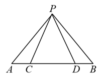

# Mathematics - 题目 3114

**ID**: 6da76fef1e674846bee2a0087342ee56
**年级**: Grade 9
**难度**: Medium
**题型**: Fill-in-the-blank

## 题目
如图，点 $P$ 在直线 $AB$ 外，点 $A$ 、 $B$ 、 $C$ 、 $D$ 均在直线 $AB$ 上，如果 $AC=BD$ ，只需添加一个条件即可证明 $ΔAPC\mathrm{≌}ΔBPD$ ，这个条件可以是（写出一个即可）．​​​​​​​‌

## 解答

1. 解：条件是∠A＝∠B
2. 理由是：∵∠A＝∠B
3. ∴PA＝PB
4. 在 $\Delta APC$ 和 $ΔBPD$ 中，
5. $\begin{cases}PA=PB\\\angle A=\angle B\\AC=BD\end{cases}$
6. ∴ $ΔAPC\mathrm{≌}ΔBPD$ （SAS）
7. 故答案为：∠A＝∠B

## 知识点

**中文**:
  - 等腰三角形的性质
  - 边角边(SAS)

**English**:
  - Properties of Isosceles Triangles
  - SAS (Side-Angle-Side)

---
