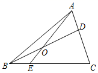

# Mathematics - 题目 2350

**ID**: 6dac53ac12b34341a2362b8ae9a85731
**年级**: Grade 9
**难度**: Medium
**题型**: Fill-in-the-blank

## 题目
如图，在 $\vartriangle ABC$ 中，D在AC边上， $AD:DC=1:2$ ，O是BD的中点，连接AO并延长交BC于E，记 $\mathrm{△}BOE$ 的面积为 $S{{}_{1}}$ ，四边形CDOE的面积为 $S{{}_{2}}$ ，则 $\frac {S{{}_{1}}}{S{{}_{2}}}=$．​​​​​​​‌

## 解答

1. 解：作DF∥AE交BC于F，连接CO，如图，
2. 
3. ∵OE∥DF，O是BD的中点，
4. ∴ ${\rm \frac {BE}{EF}=\frac {BO}{OD}=1}$ ，即BE＝EF，
5. ∵DF∥AE， ${\rm AD:DC=1:2}$ ，
6. ∴ ${\rm \frac {EF}{FC}=\frac {AD}{DC}=\frac {1}{2}}$ ，
7. ∴CF＝2EF，
8. ∴ ${\rm \frac {BE}{EC}=\frac {1}{3}}$ ，
9. ∴ ${\rm \frac {S{{}_{△BOE}}}{S{{}_{△COE}}}=\frac {1}{3}}$ ，
10. 又∵O是BD的中点，
11. ∴ ${\rm S{{}_{△BOC}}=S{{}_{△DOC}}}$ ，
12. ∴ ${\rm \frac {S{{}_{\vartriangle BOE}}}{S{{}_{\vartriangle BCD}}}=\frac {1}{8}}$ ，
13. ∴ ${\rm \frac {S{{}_{\vartriangle BOE}}}{S{{}_{四边形CDOE}}}=\frac {1}{7}}$
14. 故答案为： $\frac {1}{7}$ ．

## 知识点

**中文**:
  - 平行线分线段成比例定理

**English**:
  - Parallel Lines Intercept Theorem

---
