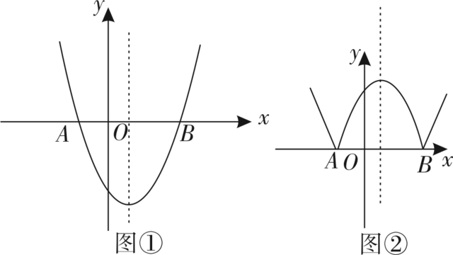

# Mathematics - 题目 22

**ID**: 6fd945024e9741c0a3a1c5b7276941c9
**年级**: Grade 9
**难度**: Medium
**题型**: Fill-in-the-blank

## 题目
已知抛物线 $y={\left({x-1}\right)^{2}}-4$ 的图象如图①所示，现将抛物线在 $x$ 轴下方的部分沿 $x$ 轴翻折，图象其余部分不变，得到一个新图象如图②，当直线 $y=x+b$ 与图象②恰有三个公共点时，则 $b$ 的值为．​​​​​​​‌

## 解答

1. 解：将抛物线 $y={\left({x-1}\right)^{2}}-4{\rm =\mathit{x}\mathit{^{2}}-2\mathit{x}-3}$ 的图象在x轴下方的部分沿x轴翻折到x轴上方，则翻折上来的部分解析式为y=-x^{2}+2x+3．
2. ∵直线y=x+b平行于y=x，
3. ∴当y=x+b经过点A或者y=x+b与y=-x^{2}+2x+3相切时，直线y=x+b与新图象恰好有三个不同的交点．
4. 
5. ①当直线y=x+b经过点A（−1，0）时，0=−1+b，
6. ∴b=1；
7. ②当y=x+b与y=-x^{2}+2x+3相切时，
8. $\begin{cases}y=x+b\\y=-x{^{2}}+2x+3\end{cases}$ 只有一组公共解，
9. 即方程x^{2}-x+b−3=0中判别式等于0，
10. ∴ ${\rm △=（-1）^{2}-4（\mathit{b}-3）=0}$ ，
11. ∴ ${\rm \mathit{b}=}\frac {13}{4}$ ．
12. 综上，b=1或 ${\rm \mathit{b}=}\frac {13}{4}$ ．

## 知识点

**中文**:
  - y=ax²+bx+c的图象与性质
  - 二次函数的综合

**English**:
  - Graph and Properties of y=ax²+bx+c
  - Comprehensive Quadratic Function Problems

---
