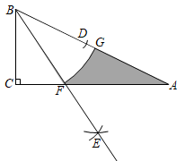

# Mathematics - 题目 2320

**ID**: 7cbc7e2a7a004939b973c65b9fbd70ab
**年级**: Grade 9
**难度**: Medium
**题型**: Fill-in-the-blank

## 题目
如图， ${\rm{R}}{\rm{t}}\mathrm{△}ABC$ 中， $\angle C=90{}^\circ $ ， $\angle A=30{}^\circ $ ， $BC=1$ ，以点B为圆心，以BC长度为半径作弧，交BA于点D，以点C为圆心，以大于 $\frac {1}{2}CD$ 为半径作弧，接着再以点D为圆心，以相同长度为半径作弧，两弧交于点E，作射线BE交CA于点F，以点B为圆心，以BF为长度作弧，交BA于点G，则阴影部分的面积为．​​​​​​​‌

## 解答

1. 解：由作图可知，BE平分 $∠ABC$ ，
2. $\because \angle C=90{}^\circ $ ， $\angle A=30{}^\circ $ ，
3. $\therefore \angle CBA=90{}^\circ -30{}^\circ =60{}^\circ $ ，
4. $\therefore \angle CBF=\angle FBA=30{}^\circ $ ，
5. $\because BC=1$ ，
6. $\therefore CF=BC\cdot {\tan}30{}^\circ =\frac {\sqrt {3}}{3}$ ， $AC=BC\cdot {\tan}60{}^\circ =\sqrt {3}$ ， $BF=2CF=\frac {2\sqrt {3}}{3}$ ，
7. ∴ $S{{}_{阴}}=S{{}_{△ABF}}$ -S_{扇形}BGF
8. ${\rm =}\frac {1}{2}\times \frac {2\sqrt {3}}{3}\times 1-\frac {30{\rm{π}}\cdot {\left({\frac {2\sqrt {3}}{3}}\right)^{2}}}{360}=\frac {\sqrt {3}}{3}-\frac {{\rm{π}}}{9}$

## 知识点

**中文**:
  - 含30度角的直角三角形
  - 扇形面积的计算
  - 解直角三角形

**English**:
  - Right Triangle with 30° Angle
  - Sector Area Calculation
  - Solving Right Triangles

---
