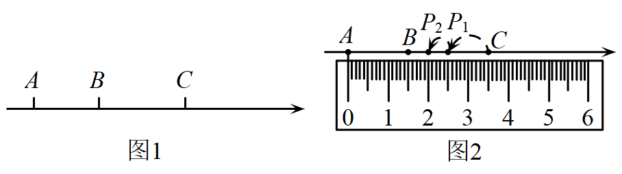

# Mathematics - 题目 3209

**ID**: 8049090a50a1471eb72e0dbe15abcb25
**年级**: Grade 9
**难度**: Medium
**题型**: Fill-in-the-blank

## 题目
如图1，A，B，C是数轴上从左到右排列的三点，在数轴上对应的数分别为 $-4$ ，b，3，某同学将刻度尺按图2方式放置，使刻度尺上的数字0对齐数轴上的点A，发现点B对齐刻度尺 $1.​​​​​​​‌5{\rm{c}}{\rm{m}}$ 处，点C对齐刻度尺 $3.5{\rm{c}}{\rm{m}}$ 处．（1）在图1的数轴上， $AC=$个单位长度．（2）数轴上点B所对应的数b为，一质点P从点C处向点B方向跳动，第一次跳动到 $CB$ 的中点 $P{{}_{1}}$ 处，第二次从 $P{{}_{1}}$ 点跳动到 $P{{}_{1}}B$ 的中点 $P{{}_{2}}$ 处，第三次从 $P{{}_{2}}$ 点跳动到 $P{{}_{2}}B$ 的中点 $P{{}_{3}}$ 处，如此跳动下去，则第四次跳动后，数轴上点 $P{{}_{4}}$ 所表示数为．

## 解答

1. 解：（1）∵A，C是数轴上从左到右排列的点，在数轴上对应的数分别为 $-4$ ，3，
2. ∴ $AC=3-\left ({-4}\right )=7$ ；
3. 故此题答案为7；
4. （2）∵刻度尺上的数字0对齐数轴上的点A，发现点B对齐刻度尺 $1.5{\rm{c}}{\rm{m}}$ 处，点C对齐刻度尺 $3.5{\rm{c}}{\rm{m}}$ 处， $AC=7$ ，
5. ∴ $b=-4+7\times \frac {1.5}{3.5}=-1$ ，
6. ∴数轴上点B对应的数b为 $-1$ ，
7. ∴ $BC=3-\left ({-1}\right )=4$ ，
8. ∵一质点P从点C处向点B方向跳动，第一次跳动到 $CB$ 的中点 $P{{}_{1}}$ 处，
9. ∴点 $P{{}_{1}}$ 表示的数为 $3-\frac {1}{2}\times 4=1$ ，
10. ∵第二次从 $P{{}_{1}}$ 点跳动到 $P{{}_{1}}B$ 的中点 $P{{}_{2}}$ 处，
11. ∴点 $P{{}_{2}}$ 表示的数为 $1-\frac {1}{2}\times \left |{1-\left ({-1}\right )}\right |=0$ ，
12. ∵第三次从 $P{{}_{2}}$ 点跳动到 $P{{}_{2}}B$ 的中点 $P{{}_{3}}$ 处，
13. ∴点 $P{{}_{3}}$ 表示的数为 $0-\frac {1}{2}\times \left |{0-\left ({-1}\right )}\right |=-\frac {1}{2}$ ，
14. ∵第四次从 $P{{}_{3}}$ 点跳动到 $P{{}_{3}}B$ 的中点 $P{{}_{4}}$ 处，
15. ∴点 $P{{}_{4}}$ 表示的数为 $-\frac {1}{2}-\frac {1}{2}\times \left |{-\frac {1}{2}-\left ({-1}\right )}\right |=-\frac {3}{4}$ ．
16. 故此题答案为： $7$ ； $-1$ ； $-\frac {3}{4}$ ．

## 知识点

**中文**:
  - 数轴上的动点问题
  - 用数轴上的点表示有理数

**English**:
  - Moving Point Problems on Number Line
  - Representing Rational Numbers on Number Line

---
