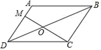

# Mathematics - 题目 1036

**ID**: 838f2ed1681440958cf58bc3d48bc080
**年级**: Grade 9
**难度**: Medium
**题型**: Fill-in-the-blank

## 题目
如图，在 $▱$ ABCD中，AM= $\frac {1}{3}$ AD，BD与MC相交于点O，则S_{△MOD}∶S_{△BOC}=．​​​​​​​‌

## 解答

1. ∵四边形ABCD是平行四边形，
2. ∴AD=BC，AD∥BC，
3. ∵AM= $\frac {1}{3}$AD，
4. ∴ $\frac {DM}{AD}=\frac {DM}{BC}=\frac {2}{3}$ ，
5. ∵AD∥BC，
6. ∴△DOM∽△BOC，
7. ∴ $\frac {S{{}_{\vartriangle DOM}}}{S{{}_{\vartriangle BOC}}}$ =（ $\frac {DM}{BC}$ ）^{2}= $\frac {4}{9}$ ，
8. 故答案为4：9．

## 知识点

**中文**:
  - 相似三角形的判定与性质综合

**English**:
  - Determination and Properties

---
