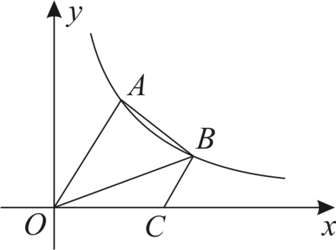

# Mathematics - 题目 1223

**ID**: 8dddbe49f88241b98a8bee660e7a3341
**年级**: Grade 9
**难度**: Medium
**题型**: Fill-in-the-blank

## 题目
如图，梯形OABC的一个顶点为平面直角坐标系的坐标原点 ${\rm \mathit{O}，}OA\mathrm{/\mskip-4mu/}BC$ ，反比例函数 $y=\frac {k}{x}$ （ $k>0$ ， $x>0$ ）经过点A、点B，已知OA＝2BC，若 ${\rm △\mathit{OAB}}$ 的面积为 $\frac {3}{2}$ ，则k的值为．​​​​​​​‌

## 解答

1. 解：如图，过点A作AD⊥x轴于点D，过点B作BE⊥x轴于点E，
2. 
3. 则 ${\rm Δ\mathit{OAD}∽Δ\mathit{CBE}}$ ，
4. ∴OA:CB=OD:CE=AD:BE=2:1，
5. 设CE=a，BE=b，则OD=2a，AD=2b，
6. ∵反比例函数y=kx(k>0,x>0)经过点A,点B，
7. ∴k=2a⋅2b=4ab，
8. ∴B(4a,b)，
9. ∴DE=2a，
10. ∴S_{Δ}OAB=S_{梯形}ADEB= $\frac {1}{2}{\rm (\mathit{AD}+\mathit{BE})}$ ⋅ ${\rm \mathit{DE}=}\frac {1}{2}{\rm (2\mathit{b}+\mathit{b})}$ ⋅ ${\rm 2\mathit{a}=}\frac {3}{2}$ ，
11. 解得 ${\rm \mathit{ab}=}\frac {1}{2}$ ，
12. ∴k=4ab=2．

## 知识点

**中文**:
  - 反比例函数系数k的几何意义及应用

**English**:
  - Geometric Meaning and Application of Coefficient k

---
