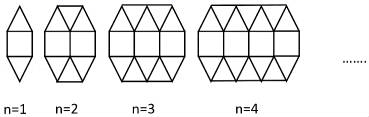

# Mathematics - 题目 2250

**ID**: 90dd8fd6c4ef4c78a29ac520c21f568b
**年级**: Grade 9
**难度**: Medium
**题型**: Fill-in-the-blank

## 题目
用形状大小完全相同的等边三角形和正方形按如图所示的规律拼图案，即从第2个图案开始每个图案比前一个图案多4个等边三角形和1个正方形，则第n个图案中等边三角形的个数为个．​​​​​​​‌

## 解答

1. 解: 由图可知: 第一个图案有正三角形2个为4 $\times $ 1-2，第二图案比第一个图案多4个为4 $\times $ 2-2个，第三个图案比第二个多4个为4 $\times $ 3-2个，
2. 可得第n个就有正三角形4n-2个.
3. 故答案为: 4n-2.

## 知识点

**中文**:
  - 规律型：图形的变化类

**English**:
  - Patterns: Geometric Variations

---
