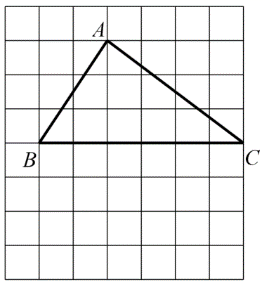

# Mathematics - 题目 3292

**ID**: 918708b5d236490a927133a874f5da2b
**年级**: Grade 9
**难度**: Medium
**题型**: Fill-in-the-blank

## 题目
如图，在每个小正方形的边长为1的网格中， $\vartriangle ABC$ 的顶点 $A,B,C$ 均在格点上．（Ⅰ） $AB$ 的长等于；​​​​​​​‌（Ⅱ）请用无刻度的直尺，在如图所示的网格中，画出点 $E,F$ ，点E在 $BC$ 上，且 $BE:CE=1:3$ ，点F在 $AB$ 上，使其满足 $\angle CEA=\angle BEF$ ，并简要说明点 $E,F$ 的位置是如何找到的（不要求证明）．

## 解答

1. 解：（1）由勾股定理得： $AB=\sqrt {2{^{2}}+3{^{2}}}=\sqrt {13}.$
2. 故答案为： $\sqrt {13}.$
3. （2）取格点 $M,N,$ 且满足 $\frac {BM}{CN}=\frac {1}{3},$  连接 $MN$ 交 $BC$ 于 $E.$
4. 理由如下：由题意知： $\vartriangle BEM∽\vartriangle CEN,$
5. $\therefore \frac {BE}{CE}=\frac {BM}{CN}=\frac {1}{3}.$
6. 所以点 $E$ 即为所求作的点．
7. 再取 $A$ 关于 $BC$ 对称的格点 $P$ ，满足 $\angle CEA=\angle PEC,$  延长 $PE$ 交 $AB$ 于 $F.$
8. 理由如下： $\because \angle CEA=\angle CFP,\angle CEP=\angle BEF,$
9. $\therefore \angle CEA=\angle BEF.$
10. 所以点 $F$ 即为所求作的点．
11. 
12. 故答案为：取格点 $M,N,$ 且满足 $\frac {BM}{CN}=\frac {1}{3},$  连接 $MN$ 交 $BC$ 于 $E.$ 再取 $A$ 关于 $BC$ 对称的格点 $P$ ，满足 $\angle CEA=\angle PEC,$  延长 $PE$ 交 $AB$ 于 $F.$

## 知识点

**中文**:
  - 勾股定理的应用
  - 轴对称的性质
  - 相似三角形的判定与性质综合

**English**:
  - Applications of Pythagorean Theorem
  - Properties of Axial Symmetry
  - Determination and Properties

---
