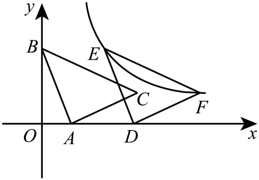

# Mathematics - 题目 2018

**ID**: 98083c2970484335a942a5bc8b07f122
**年级**: Grade 9
**难度**: Medium
**题型**: Fill-in-the-blank

## 题目
如图，已知点 $A\left ({1,0}\right )$ ，点 $B\left ({0,3}\right )$ 分别在 $x$ 轴和 $y$ 轴上；​​​​​​​‌将线段 $AB$ 绕点 $\mathrm{A}$ 顺时针旋转 $90{}\degree $ 至线段 $AC$ ，连 $BC$ ，将 $\vartriangle ABC$ 沿 $x$ 轴正方向平移至 $\vartriangle DEF$ ；当双曲线 $y=\frac {k}{x}$ 恰好同时经过点 $E$ ， $F$ 时， $k$ 的值等于．

## 解答

1. 解：设 $D\left ({a,0}\right )$ ，
2. ∵将线段 $AB$ 绕点 $\mathrm{A}$ 顺时针旋转 $90{}\degree $ 至线段 $AC$ ，点 $A\left ({1,0}\right )$ ，点 $B\left ({0,3}\right )$ ，
3. ∴点 $C$ 的横坐标为 $1+3=4$ ，纵坐标为 $1$ ，
4. ∴点 $C\left ({4,1}\right )$ ，
5. ∵将 $\vartriangle ABC$ 沿 $x$ 轴正方向平移至 $\vartriangle DEF$ ，
6. ∴ $AB\parallel DE$ ， $AB=DE$ ， $AC\parallel DF$ ， $AC=DF$ ，
7. ∴点 $E$ 的坐标为 $\left ({a,3}\right )$ ，点 $F$ 的坐标为 $\left ({4+a,1}\right )$ ，
8. 当双曲线 $y=\frac {k}{x}$ 恰好同时经过点 $E$ ， $F$ 时， $3a=4+a=k$ ，
9. 解得： $a=2$ ， $k=6$ ．

## 知识点

**中文**:
  - 反比例函数的图象
  - 反比例函数的性质
  - 坐标与图形变化——平移
  - 坐标与图形变换——旋转

**English**:
  - Graph of Inverse Proportionality Functions
  - Properties of Inverse Proportionality Functions
  - Coordinates and Translation
  - Coordinates and Rotation

---
