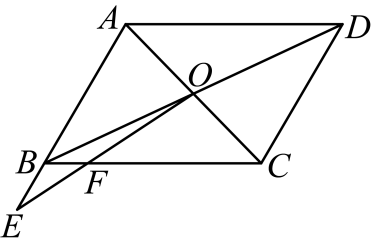

# Mathematics - 题目 3422

**ID**: 9d2680a619694a808a95ed491c1328e0
**年级**: Grade 9
**难度**: Medium
**题型**: Fill-in-the-blank

## 题目
如图，在平行四边形 $ABCD$ 中， $AB=6$ ， $BC=8$ ，对角线 $AC$ ， $BD$ 相交于点O，在 $AB$ 的延长线上取点E，使 $BE=2$ ，连接 $EO$ 交 $BC$ 于点F，则 $BF$ 的长为．​​​​​​​‌

## 解答

1. 解：过点O作 $OG{\rm{/\mskip-4mu/}}AD$ ，交 $AB$ 于点G，如图所示：
2. 
3. ∵四边形 $ABCD$ 为平行四边形，
4. ∴ $AD{\rm{/\mskip-4mu/}}BC$ ， $BO=DO=\frac {1}{2}BD$ ， $AD=BC=8$ ，
5. ∴ $OG{\rm{/\mskip-4mu/}}AD{\rm{/\mskip-4mu/}}BC$ ，
6. ∴ $\vartriangle BOG∽\vartriangle BDA$ ，
7. ∴ $\frac {OG}{AD}=\frac {BG}{AB}=\frac {BO}{BD}=\frac {1}{2}$ ，
8. ∴ $OG=\frac {1}{2}AD=4$ ， $BG=\frac {1}{2}AB=3$ ，
9. ∵ $BE=2$ ，
10. ∴ $EG=BE+BG=5$ ，
11. ∵ $BF{\rm{/\mskip-4mu/}}OG$ ，
12. ∴ $\vartriangle BEF∽\vartriangle GEO$ ，
13. ∴ $\frac {BF}{OG}=\frac {BE}{EG}=\frac {2}{5}$ ，
14. ∴ $BF=\frac {2}{5}OG=\frac {8}{5}$ ．

## 知识点

**中文**:
  - 平行四边形的对边平行且相等
  - 相似三角形的判定与性质综合

**English**:
  - Opposite Sides Parallel and Equal
  - Determination and Properties

---
