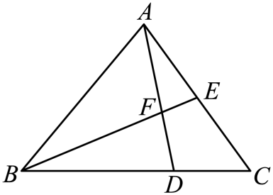

# Mathematics - 题目 2067

**ID**: 9efc1b24bb164902ab8584505f0b1fb8
**年级**: Grade 9
**难度**: Medium
**题型**: Fill-in-the-blank

## 题目
如图，在 $\vartriangle ABC$ 中，点 $D、E$ 分别在 $BC、AC$ 边上， $E$ 是 $AC$ 的中点， $AD、BE$ 相交于点 $F$ ，若 $BD=2DC,FE=7\sqrt {5}$ ，则 $FB$ 的长为．​​​​​​​‌

## 解答

1. 解：过点 $D$ 作 $GD/\mskip-4mu/AC$ 交 $BE$ 于点 $G$ ，
2. 
3. 则： $\vartriangle BDG∽\vartriangle BCE,\vartriangle AEF∽\vartriangle DGF$ ，
4. ∴ $\frac {GD}{CE}=\frac {BD}{BC}$ ， $\frac {GD}{AE}=\frac {GF}{EF}$ ，
5. ∵ $BD=2DC$ ，
6. ∴ $\frac {GD}{CE}=\frac {BD}{BC}=\frac {2}{3}$ ，
7. ∵ $E$ 是 $AC$ 的中点，
8. ∴ $AE=CE$ ，
9. ∴ $\frac {GD}{AE}=\frac {GF}{EF}=\frac {GD}{CE}=\frac {2}{3}$ ，
10. ∴ $GF=\frac {2}{3}EF=\frac {14\sqrt {5}}{3}$ ，
11. ∴ $GE=GF+EF=\frac {35\sqrt {5}}{3}$ ，
12. ∵ $GD/\mskip-4mu/AC$ ，
13. ∴ $\frac {BG}{GE}=\frac {BD}{DC}=2$ ，
14. ∴ $BG=2GE=\frac {70\sqrt {5}}{3}$ ，
15. ∴ $BF=BG+GF=\frac {70\sqrt {5}}{3}+\frac {14\sqrt {5}}{3}=28\sqrt {5}$

## 知识点

**中文**:
  - 相似三角形的判定与性质综合

**English**:
  - Determination and Properties

---
