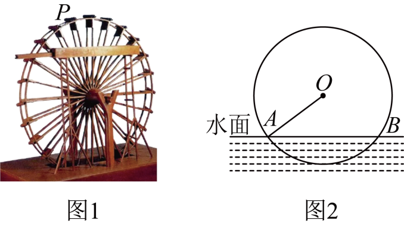

# Mathematics - 题目 1819

**ID**: abe71599ca734a55b530ad7d7c08b361
**年级**: Grade 9
**难度**: Medium
**题型**: Fill-in-the-blank

## 题目
筒车是我国古代发明的一种水利灌溉工具，彰显了我国古代劳动人民的智慧，如图1，点P表示筒车的一个盛水桶．如图2，当筒车工作时，盛水桶的运行路径是以轴心O为圆心，5m为半径的圆，且圆心在水面上方．若圆被水面截得的弦AB长为8m，则筒车工作时，盛水桶在水面以下的最大深度为m．​​​​​​​‌

## 解答

1. 解：过O点作半径OD⊥AB于E，如图，
2. ∴ ${\rm \mathit{AE}＝\mathit{BE}＝}\frac {1}{2}{\rm \mathit{AB}＝}$  $\frac {1}{2}{\rm ×8＝4}$ ，
3. 在Rt△AEO中， ${\rm \mathit{OE}＝}\sqrt {OA{^{2}}-AE{^{2}}}{\rm ＝}$  $\sqrt {5{^{2}}-4{^{2}}}{\rm ＝3}$ ，
4. ∴ED＝OD﹣OE＝5﹣3＝2（m），
5. 答：筒车工作时，盛水桶在水面以下的最大深度为2m．
6. 

## 知识点

**中文**:
  - 垂径定理的应用

**English**:
  - Applications of Perpendicular Chord Theorem

---
