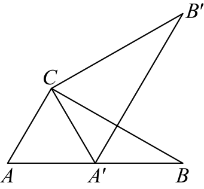

# Mathematics - 题目 2434

**ID**: b12f7d8f4feb4f3ca4da006581b8da2f
**年级**: Grade 9
**难度**: Medium
**题型**: Fill-in-the-blank

## 题目
如图，在 ${\rm{R}}{\rm{t}}\mathrm{△}ABC$ 中， $\angle ACB\mathrm{=}90{}\degree $ ， $\angle A=60{}\degree ，AC=3$ ，将 $\vartriangle ABC$ 绕点C按逆时针方向旋转得到 $\mathrm{△}A^{′}B^{′}C$ ，此时点 $A^{′}$ 恰好在 $AB$ 边上，则点 $B^{′}$ 与点B之间的距离为．​​​​​​​‌

## 解答

1. 解：如图，连接 $BB^{′}$ ；
2. 由旋转的性质得 $BC=BB^{′}，\angle BCB^{′}=60{}\degree $ ，
3. ∴ $\mathrm{△}CBB^{′}$ 是等边三角形，
4. ∴ $BC=BB^{′}$ ；
5. 在 ${\rm{R}}{\rm{t}}\mathrm{△}ABC$ ， $\angle A=60{}\degree ，AC=3$ ，
6. ∴ $\angle ABC=90{}\degree -\angle A=30{}\degree $ ，
7. ∴ $AB=2AC=6$ ，
8. 由勾股定理得 $BC=\sqrt {AB{^{2}}-AC{^{2}}}=3\sqrt {3}$ ，
9. ∴ $BB^{′}=3\sqrt {3}$ ．
10. 

## 知识点

**中文**:
  - 旋转的性质
  - 等边三角形的判定与性质
  - 解直角三角形

**English**:
  - Properties of Rotation
  - Determination and Properties
  - Solving Right Triangles

---
