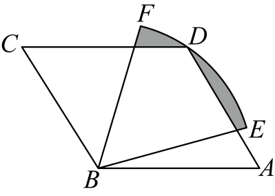

# Mathematics - 题目 2599

**ID**: b1ca8e7619d24fb2b4f41b1c07ad7188
**年级**: Grade 9
**难度**: Medium
**题型**: Fill-in-the-blank

## 题目
如图，四边形 $ABCD$ 是菱形， $\angle A=60{}\degree $ ， $AB=4$ ，扇形 $BEF$ 的半径为4，圆心角为 $60{}\degree $ ，则图中阴影部分的面积是．（结果保留 $π$ ）​​​​​​​‌

## 解答

1. 解：连接 $BD$ ，将扇形 $BDE$ 补到扇形 $BCF$ 的位置，
2. 
3. $\because AB=4$ ， 四边形 $ABCD$ 是菱形，
4. $\therefore AD=4$ ，
5. 过D作 $DH\bot AB$ 于点H，
6. $\because $  $\angle A=60{}\degree $
7. $\therefore DH=\frac {\sqrt {3}}{2}\times 4=2\sqrt {3}$ ，
8. $\therefore $   $S{{}_{\mathrm{△}BCD}}=\frac {1}{2}S{{}_{菱形ABCD}}=\frac {1}{2}AB\times DH=\frac {1}{2}\times 4\times 2\sqrt {3}=4\sqrt {3}$ ，
9. ∵扇形的圆心角为 $60{}\degree $ ， $∠CBD=\frac {1}{2}∠ABC=60{}\degree $ ，
10. $\therefore S{{}_{扇形BDE}}{\rm{=}}S{{}_{扇形BCF}}$
11. $\therefore S{{}_{扇形BCD}}{\rm{=}}S{{}_{扇形BEF}}$
12. $\therefore $  $S{{}_{阴影}}{\rm{=}}{\rm{S}}{{}_{扇形BCD}}-{\rm{S}}{{}_{\mathrm{△}BCD}}=\frac {60\times π\times 4{^{2}}}{360}-4\sqrt {3}=\frac {8}{3}π-4\sqrt {3}$ ．

## 知识点

**中文**:
  - 扇形面积的计算
  - 菱形的性质

**English**:
  - Sector Area Calculation
  - Properties of Rhombuses

---
