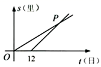

# Mathematics - 题目 732

**ID**: b6b18587f77a4a3fb4903bbe2e15486f
**年级**: Grade 9
**难度**: Medium
**题型**: Fill-in-the-blank

## 题目
元朝朱世杰的《算学启蒙》一书记载：“今有良马日行二百四十里，驽马日行一百五十里，驽马先行一十二日，问良马几何日追及之．”如图是两匹马行走路s关于行走的时间t和函数图象，则两图象交点P的坐标是．​​​​​​​‌

## 解答

1. 由题意可得，150t＝240（t﹣12），
2. 解得，t＝32，
3. 则150t＝150×32＝4800，
4. ∴点P的坐标为（32，4800），
5. 故答案为（32，4800）．

## 知识点

**中文**:
  - 行程问题

**English**:
  - Distance-Speed-Time Problems

---
