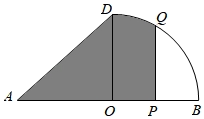

# Mathematics - 题目 3492

**ID**: c8aeeb247a4f42d1819be22b33aeec64
**年级**: Grade 9
**难度**: Medium
**题型**: Fill-in-the-blank

## 题目
如图，等腰Rt△AOD的直角边OA长为2，扇形BOD的圆心角为90°，点P是线段OB的中点，PQ⊥AB，且PQ交弧DB于点Q．则图中阴影部分的面积是．​​​​​​​‌

## 解答

1. 如图，连接 $OQ$ ，
2. 
3. $\because $ 点P是线段OB的中点，等腰Rt△AOD的直角边OA长为2，
4. $\therefore OP=\frac {1}{2}OB=\frac {1}{2}OQ=\frac {1}{2}OD=1$
5. $\because $PQ⊥AB，
6. $\therefore {\cos}\angle QOP=\frac {OP}{OQ}=\frac {1}{2}$
7. $\because $ 扇形BOD的圆心角为90°，
8. $\therefore \angle QOP=60{}^\circ ,\angle DOQ=30{}^\circ $
9. $\therefore PQ=\sqrt {OQ{^{2}}-OP{^{2}}}=\sqrt {3}$
10. $\therefore $ 图中阴影部分的面积是 $S{{}_{\vartriangle AOD}}+S{{}_{\vartriangle OPQ}}+S{{}_{扇形OPQ}}=\frac {1}{2}\times 2\times 2+\frac {1}{2}\times 1\times \sqrt {3}+\frac {30}{360}π\times 2{^{2}}=2+\frac {\sqrt {3}}{2}+\frac {1}{3}π$
11. 故答案为： $2+\frac {\sqrt {3}}{2}+\frac {1}{3}π$

## 知识点

**中文**:
  - 扇形面积的计算

**English**:
  - Sector Area Calculation

---
