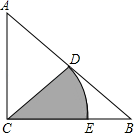

# Mathematics - 题目 626

**ID**: d21c2988000a411f8710252b6c8ddffb
**年级**: Grade 9
**难度**: Medium
**题型**: Fill-in-the-blank

## 题目
如图，在Rt△ABC中，∠ACB＝90°，∠A＝50°，AB＝8，D是AB的中点，以点C为圆心，CD长为半径画弧，交BC于点E，则图中阴影部分的面积是．（结果保留π）​​​​​​​‌

## 解答

1. 解：∵∠ACB＝90°，D是AB的中点，
2. ∴DA＝DC＝DB＝ $\frac {1}{2}$AB＝4，
3. ∵∠B＝90°﹣∠A＝90°﹣50°＝40°，
4. ∴∠DCB＝∠B＝40°，
5. ∴图中阴影部分的面积＝ $\frac {40π\cdot 4{^{2}}}{360}$ ＝ $\frac {16}{9}$ π．
6. 故答案为 $\frac {16}{9}$ π．

## 知识点

**中文**:
  - 扇形面积的计算
  - 直角三角形斜边上的中线

**English**:
  - Sector Area Calculation
  - Median to Hypotenuse of Right Triangle

---
