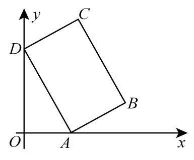

# Mathematics - 题目 2127

**ID**: d47d70d48ee44266952338981388932f
**年级**: Grade 9
**难度**: Medium
**题型**: Fill-in-the-blank

## 题目
如图，在平面直角坐标系 $xOy$ 中，矩形 $ABCD$ 的顶点 $A$ 在 $x$ 轴的正半轴上，矩形的另一个顶点 $D$ 在 $y$ 轴的正半轴上，矩形的边 $AB=a,BC=b,\angle DAO=α$ ，则点 $C$ 到 $x$ 轴的距离等于．（用含 $a$ ， $b$ ， $α$ 的式子表示）​​​​​​​‌

## 解答

1. 解：过点C作 $CH\bot y$ 轴于点H，
2. 
3. ∵四边形 $ABCD$ 是矩形，
4. ∴ $DC=AB=a,AD=BC=b,\angle ADC=90{}\degree $ ，
5. ∵ $\angle O=90{}\degree $ ，
6. ∴ $\angle 2=\angle DAO=90{}\degree -\angle 1$ ，
7. ∴ ${\cos}α={\cos}\angle 2=\frac {DH}{DC}$ ，
8. ∴ $DH=a{\cos}α$ ，
9. 而 $\sin \angle DAO=\sin α=\frac {OD}{AD}$ ，
10. ∴ $OD=b\sin α$ ，
11. ∴ $HO=DH+DO=a{\cos}α+b\sin α$ ，
12. ∵ $CH\bot y$ 轴， $\angle O=90{}\degree $ ，
13. ∴ $CH/\mskip-4mu/x$ 轴，
14. ∴点 $C$ 到 $x$ 轴的距离即为 $HO=a{\cos}α+b\sin α$ .

## 知识点

**中文**:
  - 坐标与图形性质
  - 矩形的性质
  - 解直角三角形

**English**:
  - Coordinates and Geometric Properties
  - Properties of Rectangles
  - Solving Right Triangles

---
