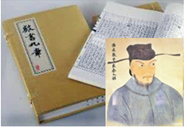

# Mathematics - 题目 2984

**ID**: d88fa6a4845a4388bdd6787afcd3ddeb
**年级**: Grade 9
**难度**: Medium
**题型**: Fill-in-the-blank

## 题目
我国南宋著名数学家秦九韶在他的著作《数书九章》一书中，给出了著名的秦九韶公式，也叫三斜求积公式，即如果一个三角形的三边长分别为a，b，c，则该三角形的面积为S= $\sqrt {\frac {1}{4}[a{^{2}}b{^{2}}-(\frac {a{^{2}}+b{^{2}}-c{^{2}}}{2}){^{2}}]}$ ．现已知△ABC的三边长分别为1，2， $\sqrt {5}$ ，则△ABC的面积为．​​​​​​​‌

## 解答

1. ∵S= $\sqrt {\frac {1}{4}\left [a{^{2}}b{^{2}}-{\left({\frac {a{^{2}}+b{^{2}}-c{^{2}}}{2}}\right)^{2}}\right ]}$ ，∴△ABC的三边长分别为1，2， $\sqrt {5}$ ，则△ABC的面积为：
2. S= $\sqrt {\frac {1}{4}\left [1{^{2}}\times 2{^{2}}-\left ({\frac {1{^{2}}+2{^{2}}-{\left({\sqrt {5}}\right)^{2}}}{2}}\right ){^{2}}\right ]}$ =1，
3. 故答案为1．
4. 【点睛】本题考查二次根式的应用，解答本题的关键是明确题意，利用题目中的面积公式解答．

## 知识点

**中文**:
  - 二次根式的乘除混合运算

**English**:
  - Mixed Multiplication and Division of Secondary Radicals

---
