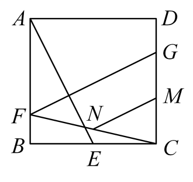

# Mathematics - 题目 3108

**ID**: dd18d199870042e485a54f9d93ea4644
**年级**: Grade 9
**难度**: Medium
**题型**: Fill-in-the-blank

## 题目
如图，点 $E$ 为正方形 $ABCD$ 的边 $BC$ 的中点，连接 $AE$ ，点 $F$ ， $G$ ，分别为 $AB$ ， $CD$ ，上的点，连接 $FG$ ， $CF$ ，取 $CG$ ， $CF$ ，的中点 $M$ ， $N$ ，连接 $MN$ ，已知正方形的边长为4，若 $FG\bot AE$ ，则 $MN$ 的长为．​​​​​​​‌

## 解答

1. 解：过点 $G$ 作 $GH\bot AB$ 于点 $H$ ，如图：
2. 
3. ∵四边形 $ABCD$ 是正方形，
4. ∴ $AB=AD$ ， $\angle ABC=\angle BAD=\angle ADC=90{}\degree $ ，
5. ∵ $GH\bot AB$ ，
6. ∴ $\angle GHA=90{}\degree $ ，
7. ∴四边形 $ADGH$ 为矩形，
8. ∴ $AD=GH$ ，
9. ∴ $GH=AB$ ，
10. ∵ $FG\bot AE$ ， $GH\bot AB$ ，
11. ∵ $\angle AFG=\angle AFG$ ，
12. ∴ $\angle BAE=180{}\degree -90{}\degree -\angle AFG$ ， $\angle HGF=180{}\degree -90{}\degree -\angle AFG$ ，
13. ∴ $\angle BAE=\angle HGF$ ，
14. 在 $\vartriangle ABE$ 和 $△GHF$ 中，
15. $\begin{cases}\angle ABC=\angle FHG=90{}\degree \\AB=GH\\\angle BAE=\angle HGF\end{cases}$ ，
16. ∴ $\mathrm{△}ABE≌\mathrm{△}GHF$ ，
17. ∴ $GF=AE$ ，
18. 在 ${\rm{R}}{\rm{t}}△ABE$ 中， $AE=\sqrt {AB{^{2}}+BE{^{2}}}=2\sqrt {5}$ ，
19. ∴ $GF=2\sqrt {5}$ ，
20. ∵点 $M$ ， $N$ 分别是线段 $CG$ ， $CF$ 的中点，
21. ∴ $MN$ 是 $\mathrm{△}CGF$ 的中位线，
22. ∴ $MN=\frac {1}{2}FG$ ，
23. 即 $MN=\frac {1}{2}\times 2\sqrt {5}=\sqrt {5}$ ．

## 知识点

**中文**:
  - 三角形中位线
  - 矩形的判定与性质综合
  - 正方形的性质
  - 全等三角形的判定与性质

**English**:
  - Triangle Midsegment
  - Determination and Properties of Rectangles
  - Properties of Squares
  - Determination and Properties

---
