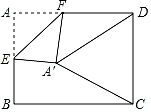

# Mathematics - 题目 2469

**ID**: e0025d7a94924bc6a6fa3b7befe205d6
**年级**: Grade 9
**难度**: Medium
**题型**: Fill-in-the-blank

## 题目
如图，在矩形纸片ABCD中，AB＝4，BC＝4 $\sqrt {2}$ ，点E是AB的中点，点F是AD边上的一个动点，将△AEF沿EF所在直线翻折，得到△A'EF，连接A'C，A'D，则当△A'DC是以A'D为腰的等腰三角形时，FD的长是．​​​​​​​‌

## 解答

1. 解：①当A′D=DC时，如图1，连接ED，
2. 
3. ∵点E是AB的中点，AB=4，BC=4 $\sqrt {2}$ ，四边形ABCD是矩形，
4. ∴AD=BC=4 $\sqrt {2}$ ，∠A=90°，
5. ∴DE= $\sqrt {AE{^{2}}+AD{^{2}}}$ =6，
6. ∵将△AEF沿EF所在直线翻折，得到△A'EF，
7. ∴A′E=AE=2，
8. ∵A′D=DC=AB=4，
9. ∴DE=A′E+A′D=6，
10. ∴点E，A′，D三点共线，
11. ∵∠A=90°，
12. ∴∠FA′E=∠FA′D=90°，
13. 
14. 设AF=x，则A′F=x，FD=4 $\sqrt {2}$ -x，
15. 在Rt△FA′D中，4^{2}+x^{2}=（4 $\sqrt {2}$ -x）^{2}，
16. 解得：x= $\sqrt {2}$ ，
17. ∴FD=3 $\sqrt {2}$ ；
18. ②当A′D=A′C时，如图2，
19. ∵A′D=A′C，
20. ∴点A′在线段CD的垂直平分线上，
21. ∴点A′在线段AB的垂直平分线上，
22. ∵点E是AB的中点，
23. ∴EA′是AB的垂直平分线，
24. ∴∠AEA′=90°，
25. ∵将△AEF沿EF所在直线翻折，得到△A'EF，
26. ∴∠A=∠EA′F=90°，AF=FA′，
27. ∴四边形AEA′F是正方形，
28. ∴AF=AE=2，
29. ∴DF=4 $\sqrt {2}$ -2，
30. 故此题答案为：4 $\sqrt {2}$ -2或3 $\sqrt {2}$ ．

## 知识点

**中文**:
  - 折叠问题
  - 矩形的性质
  - 正方形的判定与性质综合

**English**:
  - Folding Problems
  - Properties of Rectangles
  - Determination and Properties of Squares

---
