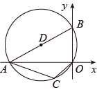

# Mathematics - 题目 3837

**ID**: e590ea74792a47f6bdec3a18ea857b3b
**年级**: Grade 9
**难度**: Medium
**题型**: Fill-in-the-blank

## 题目
如图，在平面直角坐标系 ${\rm xOy}$ 中，点A在 $x$ 轴负半轴上，点B在 $y$ 轴正半轴上，⊙D经过A，B，O，C四点，∠ACO＝120°，AB＝4，则圆心点D的坐标是​​​​​​​‌

## 解答

1. 解：∵四边形ABOC为圆的内接四边形，
2. ∴∠ABO＋∠ACO＝180°，
3. ∴∠ABO＝180°−120°＝60°，
4. ∵∠AOB＝90°，
5. ∴AB为⊙D的直径，
6. ∴D点为AB的中点，
7. 在Rt△ABO中，∵∠ABO＝60°，
8. ∴OB＝ $\frac {1}{2}$AB＝2，
9. ∴OA＝ $\sqrt {3}$OB＝2 $\sqrt {3}$ ，
10. ∴A（−2 $\sqrt {3}$ ，0），B（0，2），
11. ∴D点坐标为（− $\sqrt {3}$ ，1）．
12. 故答案为（− $\sqrt {3}$ ，1）．

## 知识点

**中文**:
  - 圆内接四边形
  - 坐标与图形性质
  - 圆周角定理及推论

**English**:
  - Cyclic Quadrilaterals
  - Coordinates and Geometric Properties
  - Inscribed Angle Theorem

---
