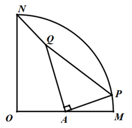

# Mathematics - 题目 2400

**ID**: f0fbda10a00a44e98870f206c8d293fe
**年级**: Grade 9
**难度**: Medium
**题型**: Fill-in-the-blank

## 题目
如图， $\angle MON=90{}\degree ,OM=ON=6$ ，以点O为圆心， $OM$ 为半径作弧 $MN$ ，点A是 $OM$ 中点，点P是弧 $MN$ 上的动点，以 $AP$ 为直角边作 ${\rm{R}}{\rm{t}}\vartriangle APQ$ ，且 ${\tan}\angle APQ=\frac {4}{3}$ ，连接 $NQ$ ，则 $NQ$ 的最小值为 $=$．​​​​​​​‌

## 解答

1. 解：将线段 $AO$ 绕点A旋转 $90{}\degree $ 并延长至点D，使得 $AD=\frac {4}{3}AO$ ，过点D作 $DH\bot NO$ ，交 $NO$ 延长线于点H，连接 $ND,DQ,OP$ ，
2. 
3. ∵在 ${\rm{R}}{\rm{t}}\vartriangle APQ$ 中， ${\tan}\angle APQ=\frac {4}{3}$ ，
4. ∴ $\frac {AQ}{AP}=\frac {4}{3}$ ，
5. ∵ $AD=\frac {4}{3}AO$ ，即 $\frac {AD}{OA}=\frac {4}{3}$ ，
6. ∵ $\angle PAQ+\angle OAQ=\angle OAD+\angle OAQ$ ，
7. ∴ $\angle PAQ=\angle OAD$ ，
8. $\therefore \vartriangle OAP∽\vartriangle DAQ$ ，
9. ∴ $\frac {OP}{DQ}=\frac {OA}{DA}=\frac {3}{4}$ ，
10. ∵ $OP=OM=6$ ，
11. ∴ $DQ=8$ ，
12. ∴点Q在以 $D$ 为圆心， $DQ=8$ 为半径的圆上运动，
13. 当 $N,Q,D$ 三点共线时， $NQ$ 由最小值，最小值为 $DN-DQ$ ，
14. ∵ $\angle AOH=\angle OAD=\angle H=90{}\degree $ ，
15. ∴四边形 $AOHD$ 是矩形，
16. ∴ $DH=OA,OH=AD$ ，
17. ∵ $OM=ON=6$ ，点A是 $OM$ 中点，
18. ∴ $OA=\frac {1}{2}OM=3$ ，
19. ∴ $DH=OA=3,OH=AD=\frac {4}{3}OA=4$ ，
20. ∴ $NH=ON+OH=10$ ，
21. ∴在 ${\rm{R}}{\rm{t}}\vartriangle NHD$ 中， $DN=\sqrt {NH{^{2}}+DH{^{2}}}=\sqrt {109}$ ，
22. ∴ $NQ$ 的最小值为 $DN-DQ=\sqrt {109}-8$

## 知识点

**中文**:
  - 相似三角形的判定与性质综合
  - 矩形的判定与性质综合
  - 解直角三角形

**English**:
  - Determination and Properties
  - Determination and Properties of Rectangles
  - Solving Right Triangles

---
