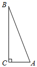

# Mathematics - 题目 1508

**ID**: f19a39ce21f946989284f098cf101282
**年级**: Grade 9
**难度**: Medium
**题型**: Fill-in-the-blank

## 题目
如图，在Rt△ABC中，∠C＝90°，AB＝13，AC＝5，则cosA的值是．​​​​​​​‌

## 解答

1. 解：在Rt△ABC中，cosA＝ $\frac {AC}{AB}$ ＝ $\frac {5}{13}$ ，
2. 故答案为： $\frac {5}{13}$ .

## 知识点

**中文**:
  - 余弦

**English**:
  - Cosine

---
