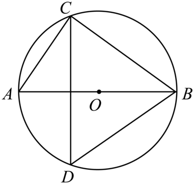

# Mathematics - 题目 1460

**ID**: f37c7c79cd96458bac6c9cd65c9b3ce9
**年级**: Grade 9
**难度**: Medium
**题型**: Fill-in-the-blank

## 题目
如图， $\vartriangle ABC$ 内接于 $\odot O$ ， $AB$ 是 $\odot O$ 的直径，点 $D$ 是 $\odot O$ 上一点， $\angle CDB=55{}^\circ $ ，则 $\angle ABC=$${}^\circ $ ．​​​​​​​‌

## 解答

1. 解： $\because \angle A,\angle CDB$ 是 $\overset ⌢{{BC}}$ 所对的圆周角，
2. $\therefore \angle A=\angle CDB=55{}^\circ ,$
3. $\because AB$ 是 $\odot O$ 的直径，
4. $\because \angle ACB=90{}^\circ $ ，
5. 在 ${\rm{R}}{\rm{t}}\mathrm{△}ACB$ 中， $\angle ABC=90{}^\circ -\angle A=90{}^\circ -55{}^\circ =35{}^\circ $ ，
6. 故答案为:  $35$ ．
7. 【点睛】本题考查了圆周角定理，以及直角三角形的性质，利用了转化的思想，熟练掌握圆周角定理是解本题的关键．

## 知识点

**中文**:
  - 圆周角定理及推论
  - 直角三角形的性质

**English**:
  - Inscribed Angle Theorem
  - Properties of Right Triangles

---
