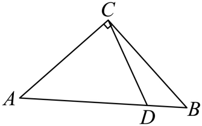

# Mathematics - 题目 1123

**ID**: fd993c893bf4414a84bba0a157b563d1
**年级**: Grade 9
**难度**: Medium
**题型**: Fill-in-the-blank

## 题目
如图，已知 ${\rm{R}}{\rm{t}}\mathrm{△}ABC$ 中， $\angle ACB\mathrm{=}90{}\degree $ ， $\angle B=45{}\degree $ ， $BC=3{\rm ，\mathit{D}}$ 是边 $AB$ 上的一点，将 $\mathrm{△}BCD$ 沿直线 $CD$ 翻折，使点B落在点 $B{{}_{1}}$ 的位置，若 $B{{}_{1}}D\bot BC$ ，则 $\angle BCB{{}_{1}}=$${}\degree $ ， $BD=$．​​​​​​​‌

## 解答

1. 解：如图：延长 $B{{}_{1}}D$ 交 $BC$ 于E，过C作 $CF\bot AB$ ，则 $\angle BCF=45{}\degree $ ，
2. 
3. ∵ $\angle B=45{}\degree $ ，
4. ∴ $\angle BDE=45{}\degree $ ，
5. ∴ $\angle B{{}_{1}}DF=45{}\degree $ ，
6. ∵将 $\mathrm{△}BCD$ 沿直线 $CD$ 翻折，使点B落在点 $B{{}_{1}}$ 的位置，
7. ∴ $\angle B{{}_{1}}=\angle B=45{}\degree $ ，
8. ∴ $\angle B{{}_{1}}DF+\angle B{{}_{1}}=90{}\degree $ ，
9. ∴ $CB{{}_{1}}\bot AB$ ，即 $CB{{}_{1}}$ 与 $CF$ 重合，
10. ∴ $\angle BCB{{}_{1}}=\angle BCF=45{}\degree $ ；
11. ∴ $\angle FCD=\angle DCE$ ，
12. ∵ $DF\bot CF,DE\bot BC$
13. ∴ $FD=DE$ ，
14. 设 $BD=x$ ，则 $BE=DE=FD=\frac {\sqrt {2}}{2}x$ ，
15. ∵ ${\rm{R}}{\rm{t}}\mathrm{△}ABC$ 中， $\angle ACB\mathrm{=}90{}\degree $ ， $\angle B=45{}\degree $ ， $BC=3$ ，
16. ∴ $AC=BC=3$ ， $AB=\sqrt {AC{^{2}}+BC{^{2}}}=3\sqrt {2}$ ，
17. ∴ $BF=\frac {3}{2}\sqrt {2}$ ，
18. ∵ $FD+BD=FB$ ，即 $\frac {\sqrt {2}}{2}x+x=\frac {3}{2}\sqrt {2}$ ，解得： $x=3\sqrt {2}-3$ ，
19. ∴ $BD=3\sqrt {2}-3$ ．

## 知识点

**中文**:
  - 折叠问题
  - 等腰直角三角形的性质

**English**:
  - Folding Problems
  - Properties of Isosceles Right Triangles

---
