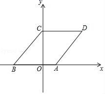

# Mathematics - 题目 3337

**ID**: 011ed029aa36407889c78574a3dbc1c8
**年级**: Grade 9
**难度**: Medium-Hard
**题型**: Calculation

## 题目
如图，在平面直角坐标系中，菱形ABCD的边AB在x轴上，点B坐标（﹣3，0），点C在y轴正半轴上，且sin∠CBO= $\frac {4}{5}$ ，点P从原点O出发，以每秒一个单位长度的速度沿x轴正方向移动，移动时间为t（0⩽t⩽5）秒，过点P作平行于y轴的直线l，直线l扫过四边形OCDA的面积为S．（1）求点D坐标．（2）求S关于t的函数关系式．（3）在直线l移动过程中，l上是否存在一点Q，使以B、C、Q为顶点的三角形是等腰直角三角形？若存在，直接写出Q点的坐标；​​​​​​​‌若不存在，请说明理由．

## 解答

1. （1）在Rt△BOC中，OB=3，sin∠CBO= $\frac {4}{5}=\frac {OC}{CB}$ ，设CO=4k，BC=5k，
2. ∵BC^{2}=CO^{2}+OB^{2}，
3. ∴25k^{2}=16k^{2}+9，
4. ∴k=1或﹣1（舍去），
5. BC=5，OC=4，
6. ∵四边形ABCD是菱形，
7. ∴CD=BC=5，
8. ∴D（5，4）；
9. （2）①如图1中，当0⩽t⩽2时，直线l扫过的图象是四边形CCQP，S=4t．
10. 
11. ②如图2中，当2＜t⩽5时，直线l扫过的图形是五边形OCQTA．
12. 
13. S=S_{梯形}_{OCDA}﹣S_{△DQT}= $\frac {1}{2}$ ×（2+5）×4﹣ $\frac {1}{2}$ ×（5﹣t）× $\frac {4}{3}$ （5﹣t）=﹣ $\frac {2}{3}$ t^{2}+ $\frac {20}{3}$ t﹣ $\frac {8}{3}$ ，
14. ∴ $S=\begin{cases}4t\left ({0\leqslant t\leqslant 2}\right )\\-\frac {2}{3}t{^{2}}+\frac {20}{3}t-\frac {8}{3}\left ({2＜t\leqslant 5}\right )\end{cases}$ ；
15. （3）如图3中，①当QB=QC，∠BQC=90°，Q（ $\frac {1}{2}$ ， $\frac {1}{2}$ ）；
16. ②当BC=CQ′，∠BCQ′=90°时，Q′（4，1）；
17. ③当BC=BQ″，∠CBQ″=90°时，Q″（1，﹣3）；
18. 
19. 综上所述，满足条件的点Q坐标为（ $\frac {1}{2}$ ， $\frac {1}{2}$ ）或（4，1）或（1，﹣3）．

## 知识点

**中文**:
  - 二次函数的图象和性质
  - 菱形的判定与性质综合
  - 正弦

**English**:
  - Graphs and Properties of Quadratic Functions
  - Determination and Properties of Rhombuses
  - Sine

---
