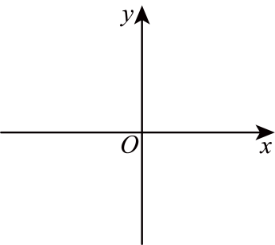

# Mathematics - 题目 3857

**ID**: 02d652542dee47b4b2b0913dffe1e3bc
**年级**: Grade 9
**难度**: Medium-Hard
**题型**: Calculation

## 题目
在平面直角坐标系 $xOy$ 中，函数 $F{{}_{1}}:y=\frac {1}{2}x{^{2}}-\frac {1}{2}\left ({m+2\sqrt {3}}\right )x+\frac {1}{4}m{^{2}}+3$ （m为常数）的图象与x轴只有一个公共点．（1）求函数 $F{{}_{1}}$ 的表达式．（2）函数 $F{{}_{1}}$ 的图象与x轴的交点为A，与y轴的交点为B．将函数 $F{{}_{1}}$ 的图象先向左平移 $2\sqrt {3}$ 个单位长度，再向下平移6个单位长度，得到新的函数 $F{{}_{2}}$ ，函数 $F{{}_{2}}$ 的图象的顶点是点C，与x轴负半轴的交点为D，过点B作x轴的平行线，与函数 $F{{}_{1}}$ 的图象的交点为E．①点A是否在函数 $F{{}_{2}}$ 的图象上？请说明理由；​​​​​​​‌②求证：四边形 $BDAE$ 是菱形．（3）在（2）的条件下，将函数 $F{{}_{2}}$ 的图象向左平移t个单位长度 $\left ({0<t<2\sqrt {3}}\right )$ ，设点A，C的对应点分别为 $A^{′}$ ， $C^{′}$ ，当线段 $BA^{′}$ 与线段 $BC^{′}$ 的和最小时，求t的值．

## 解答

1. （1）解：∵函数 $F{{}_{1}}$ 的图象与x轴仅有一个公共点，
2. ∴ $Δ=b{^{2}}-4ac$
3. $=\left [-\frac {1}{2}\left ({m+2\sqrt {3}}\right )\right ]{^{2}}-4\times \frac {1}{2}\times \left ({\frac {1}{4}m{^{2}}+3}\right )$
4. $=\frac {1}{4}{\left({m+2\sqrt {3}}\right)^{2}}-2\left ({\frac {1}{4}m{^{2}}+3}\right )$
5. $=\frac {1}{4}\left ({m{^{2}}+4\sqrt {3}m+12}\right )-\left ({\frac {1}{2}m{^{2}}+6}\right )$
6. $=\frac {1}{4}m{^{2}}+\sqrt {3}m+3-\frac {1}{2}m{^{2}}-6$
7. $=-\frac {1}{4}m{^{2}}+\sqrt {3}m-3$
8. $=-\frac {1}{4}{\left({m-2\sqrt {3}}\right)^{2}}$
9. $=0$ ．
10. ∴ $m{{}_{1}}=m{{}_{2}}=2\sqrt {3}$ ．
11. 故 $y=\frac {1}{2}x{^{2}}-\frac {1}{2}\times \left ({2\sqrt {3}+2\sqrt {3}}\right )x+\frac {1}{4}\times {\left({2\sqrt {3}}\right)^{2}}+3$ ，
12. 整理得 $y=\frac {1}{2}x{^{2}}-2\sqrt {3}x+6$ ，
13. ∴函数 $F{{}_{1}}$ 的表达式为 $y=\frac {1}{2}x{^{2}}-2\sqrt {3}x+6$ ．
14. （2）解：由（1）可知，函数 $F{{}_{1}}$ 的表达式为 $y=\frac {1}{2}x{^{2}}-2\sqrt {3}x+6$ ，
15. 则 $y=\frac {1}{2}\left ({x{^{2}}-4\sqrt {3}x+12}\right )=\frac {1}{2}{\left({x-2\sqrt {3}}\right)^{2}}$ ．
16. ∵将函数 $F{{}_{1}}$ 的图象先向左平移 $2\sqrt {3}$ 个单位长度，再向下平移6个单位长度，得到新的函数 $F{{}_{2}}$ ，
17. ∴函数 $F{{}_{2}}$ 的表达式为 $y=\frac {1}{2}{\left({x-2\sqrt {3}+2\sqrt {3}}\right)^{2}}-6=\frac {1}{2}x{^{2}}-6$ ．
18. ∴函数 $F{{}_{2}}$ 的图象的顶点是点 $C\left ({0,-6}\right )$ ，
19. ①点A在函数 $F{{}_{2}}$ 的图象上．理由如下：
20. ∵函数 $F{{}_{1}}$ 的图象与x轴的交点为A，
21. ∴把 $y=0$ 代入 $y=\frac {1}{2}{\left({x-2\sqrt {3}}\right)^{2}}$ ，
22. 得 $0=\frac {1}{2}{\left({x-2\sqrt {3}}\right)^{2}}$ ，
23. ∴ $x=2\sqrt {3}$ ，
24. ∴点A的坐标为 $\left ({2\sqrt {3},0}\right )$ ．
25. 将 $x=2\sqrt {3}$ 代入 $F{{}_{2}}$ ，可得 $y=\frac {1}{2}\times {\left({2\sqrt {3}}\right)^{2}}-6=0$ ．
26. ∴点A在函数 $F{{}_{2}}$ 的图象上．
27. ②证明：将 $x=0$ 代入 $y=\frac {1}{2}{\left({x-2\sqrt {3}}\right)^{2}}$ ，
28. ∴ $y=\frac {1}{2}\times {\left({0-2\sqrt {3}}\right)^{2}}=\frac {1}{2}\times 12=6$
29. ∴点B的坐标为 $\left ({0,6}\right )$ ．
30. ∴ $OB=6$ ．
31. 将 $y=6$ 代入 $y=\frac {1}{2}{\left({x-2\sqrt {3}}\right)^{2}}$ ，
32. 得 $\frac {1}{2}x{^{2}}-2\sqrt {3}x+6=6$ ．
33. ∴解得 $x{{}_{1}}=0$ ， $x{{}_{2}}=4\sqrt {3}$ ．
34. ∴点E的坐标为 $\left ({4\sqrt {3},6}\right )$ ．
35. ∴ $BE=4\sqrt {3}$ ．
36. 将 $y=0$ 代入 $y=\frac {1}{2}x{^{2}}-6$ ，可得 $\frac {1}{2}x{^{2}}-6=0$ ．
37. 解得 $x{{}_{3}}=2\sqrt {3}$ ， $x{{}_{4}}=-2\sqrt {3}$ ．
38. ∴点D的坐标为 $\left ({-2\sqrt {3},0}\right )$ ．
39. ∴ $OD=2\sqrt {3}$ ．
40. ∴ $AD=2\sqrt {3}-\left ({-2\sqrt {3}}\right )=4\sqrt {3}$ ．
41. ∴ $BE=AD$ ．
42. ∵ $BE\mathrm{/\mskip-4mu/}x$ 轴，
43. ∴四边形 $BDAE$ 是平行四边形．
44. 在 ${\rm{R}}{\rm{t}}\mathrm{△}BDO$ 中， $\angle BOD=90{}\degree $ ，
45. 根据勾股定理可得， $BD=\sqrt {OB{^{2}}+OD{^{2}}}=\sqrt {6{^{2}}+{\left({2\sqrt {3}}\right)^{2}}}=4\sqrt {3}.$
46. ∴ $BD=AD$ ．
47. ∴ $▱BDAE$ 是菱形．
48. （3）解：如图，作点 $A^{′}$ 关于 $BE$ 的对称点P，连接 $PB$ ，
49. 则 $PB=A^{′}B$ ．当点P、B、 $C^{′}$ 在同一直线上时，线段 $BA^{′}$ 与线段 $BC^{′}$ 的和最小．
50. 延长 $C{^{\prime }}C$ ，交 $PA^{′}$ 的延长线于点M，设 $PA^{′}$ 与 $BE$ 相交于点N．
51. ∵在（2）的条件下，将函数 $F{{}_{2}}$ 的图象向左平移t个单位长度 $\left ({0<t<2\sqrt {3}}\right )$ ，设点A，C的对应点分别为 $A^{′}$ ， $C^{′}$ ，点A的坐标为 $\left ({2\sqrt {3},0}\right )$ ， $C\left ({0,-6}\right )$ ，
52. 
53. ∴ $A^{′}{\left ({2\sqrt {3}-t,0}\right )}$ ， $C^{′}{\left ({-t,-6}\right )}$ ， $M\left ({2\sqrt {3}-t,-6}\right )$
54. ∵点B的坐标为 $\left ({0,6}\right )$ ．
55. 则 $P\left ({2\sqrt {3}-t,12}\right )$ ， $N\left ({2\sqrt {3}-t,6}\right )$
56. ∴ $PN=12-6=6$ ， $PM=12-\left ({-6}\right )=18$ ， $BN=2\sqrt {3}-t$ ， $C^{′}M=2\sqrt {3}-t-\left ({-t}\right )=2\sqrt {3}$ ．
57. ∵ $\angle P=\angle P$ ， $\angle PNB=\angle PMC^{′}=90{}\degree $ ，
58. ∴ $\mathrm{△}PBN∽\mathrm{△}PC^{′}M$ ．
59. ∴ $\frac {PN}{PM}=\frac {BN}{C^{′}M}$ ．
60. ∴ $\frac {6}{18}=\frac {2\sqrt {3}-t}{2\sqrt {3}}$ ．
61. ∴ $t=\frac {4}{3}\sqrt {3}$ ．

## 知识点

**中文**:
  - 二次函数图象的平移
  - 二次函数的综合
  - 菱形的判定
  - 相似三角形的判定与性质综合

**English**:
  - Translation of Quadratic Graphs
  - Comprehensive Quadratic Function Problems
  - Determination of Rhombuses
  - Determination and Properties

---
