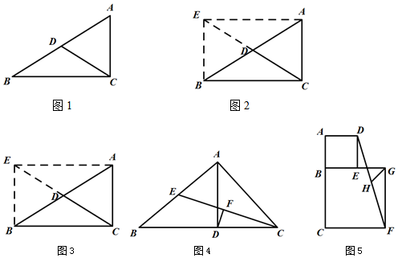

# Mathematics - 题目 1191

**ID**: 0327ca0b77974ca4a458db9bd0f6e640
**年级**: Grade 9
**难度**: Medium-Hard
**题型**: Calculation

## 题目
【教材呈现】下图是华师版九年级上册数学教材102﹣103页的部分内容．性质：直角三角形的斜边中线等于斜边的一半给出上述性质证明中的部分演绎推理的过程如下：已知：如图1，在△ABC中，∠ACB＝90°，CD为斜边AB上的中线．求证：CD＝AB证明：如图2，延长CD至点E，使DE＝CD，连接AE，BE．【问题解决】请结合图3将证明过程补充完整．【应用探究】（1）如图4，在△ABC中，AD是高，CE是中线，点F是CE的中点，DF⊥CE，点F为垂足，∠AEC＝78°，则∠BCE为度．（2）如图5，在线段AC上有一点B，AB＝4，AC＝11，分别以AB和BC为边作正方形ABED和正方形BCFG，点E落在边BG上，连接DF，点H为DF的中点，连接GH，则GH的长为．​​​​​​​‌

## 解答

1. 问题解决：如图3，延长CD至点E，使DE＝CD，连接AE，BE
2. $\because $CD为斜边AB上的中线，
3. $\therefore AD=BD$ ,
4. $\because DE=CD$ ，
5. $\therefore $ 四边形 $ACBE$ 是平行四边形
6. 又 $\because \angle ACB=90{}^\circ $
7. $\therefore $ 四边形 $ACBE$ 是矩形，
8. $\therefore $  $CE=AB$
9. $\therefore CD=\frac {1}{2}CE=\frac {1}{2}AB$
10. $\therefore $ 直角三角形的斜边中线等于斜边的一半
11. 应用探究：（1）连接 $ED$ ，如图，
12. 
13. 设 $\angle BCE{\rm{=}}α$
14. $\because AD$ 是 $\vartriangle ABC$ 的高
15. $\therefore AD\bot BC$
16. $\because CE$ 是中线
17. $\therefore AE=EB$
18. $\therefore $  $Rt\vartriangle ABD$ 中， $DE=\frac {1}{2}AB=AE=BE$
19. $\therefore \angle EDB=\angle EBD$
20. $\because $ 点F是CE的中点，DF⊥CE，
21. $\therefore DE=DC$
22. $\therefore \angle DEC=\angle DCE=α$
23. $\therefore \angle EDB=\angle DEC+\angle DCE=2α$
24. $\therefore \angle EBD=\angle EDB=2α$
25. $\therefore \angle AEC=\angle B+\angle ECB=3α$
26. $\because \angle AEC=78{}^\circ $
27. $3α=78{}^\circ $
28. $\therefore α=26{}^\circ $
29. 即 $\angle BCE=26{}^\circ $
30. 故答案为： $26$
31. （2）如图，延长 $FG$ 至 $M$ ，使得 $GM=GF$ ，过点 $D$ 作 $DN\bot MG$ 于点 $N$ ，
32. 
33. $\because $ 四边形 $ABED,BCFG$ 是正方形，AB＝4，AC＝11，则四边形 $DNGE$ 是矩形
34. $\therefore FG=BC=AC-AB=11-4=7$
35. $\therefore MN=MG-NG=7-4=3$ ， $DN=EG=BG-BE=7-4=3$
36. $Rt△MND$ 中 $DM=\sqrt {3{{}^{2}}+3{{}^{2}}}=3\sqrt {2}$
37. $\because MG=GF$ ， $H$H为DF的中点，
38. $\therefore HG=\frac {1}{2}DM=\frac {3\sqrt {2}}{2}$
39. 故答案为： $\frac {3\sqrt {2}}{2}$
40. 【点睛】本题考查了正方形的性质，矩形的性质与判定，平行四边形的性质，直角三角形斜边上的中线等于斜边的一半，掌握直角三角形斜边上的中线等于斜边的一半是解题的关键．

## 知识点

**中文**:
  - 正方形的判定与性质综合
  - 直角三角形斜边上的中线
  - 矩形的判定与性质综合

**English**:
  - Determination and Properties of Squares
  - Median to Hypotenuse of Right Triangle
  - Determination and Properties of Rectangles

---
