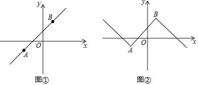

# Mathematics - 题目 1605

**ID**: 0345c7816e6b444aa231ed8555038cc6
**年级**: Grade 9
**难度**: Medium-Hard
**题型**: Calculation

## 题目
已知：在平面直角坐标系xOy中，点A（x_{1}，y_{1}）、B（x_{2}，y_{2}）是某函数图象上任意两点（x_{1}＜x_{2}），将函数图象中x＜x_{1}的部分沿直线y＝y_{1}作轴对称，x＞x_{2}的部分沿直线y＝y_{2}作轴对称，与原函数图象中x_{1}⩽x⩽x_{2}的部分组成了一个新函数的图象，称这个新函数为原函数关于点A、B的“双对称函数”．例如：如图①，点A（﹣2，﹣1）、B（1，2）是一次函数y＝x+1图象上的两个点，则函数y＝x+1关于点A、B的“双对称函数”的图象如图②所示．（1）点A（t，y_{1}）、B（t+3，y_{2}）是函数y＝ $\frac {3}{x}$ 图象上的两点，y＝ $\frac {3}{x}$ 关于点A、B的“双对称函数”的图象记作G，若G是中心对称图形，直接写出t的值．（2）点P（ $\frac {1}{2}$ ，y_{1}），Q（ $\frac {1}{2}$ +t，y_{2}）是二次函数y＝（x﹣t）^{2}+2t图象上的两点，该二次函数关于点P、Q的“双对称函数”记作f．①求P、Q两点的坐标（用含t的代数式表示）．②当t＝﹣2时，求出函数f的解析式；​​​​​​​‌③若﹣1⩽x⩽1时，函数f的最小值为y_{min}，求﹣2⩽y_{min}⩽﹣1时，t的取值范围．

## 解答

1. 解：（1）如图1，
2. 
3. 设点A（t， $\frac {3}{t}$ ），A′（t+3， $\frac {3}{t+3}$ ），
4. ∵G是中心对称图形，由反比例函数图象的中心对称性质可知：A与A′关于原点成中心对称，
5. ∴t+t+3＝0，解得：t＝ $-\frac {3}{2}$ ；
6. （2）①y_{1}＝ ${\left({\frac {1}{2}-t}\right)^{2}}$ +2t＝t^{2}+t+ $\frac {1}{4}$ ，y_{2}＝ ${\left({\frac {1}{2}+t-t}\right)^{2}}$ +2t＝2t+ $\frac {1}{4}$
7. ∴P（ $\frac {1}{2}$ ，t^{2}+t+ $\frac {1}{4}$ ），Q（ $\frac {1}{2}$ +t，2t+ $\frac {1}{4}$ ），
8. ②当t＝﹣2时，y＝（x+2）^{2}﹣4，P（ $\frac {1}{2}$ ， $\frac {9}{4}$ ），Q（ $-\frac {3}{2}$ ， $-\frac {15}{4}$ ），根据“双对称函数”定义可知：
9. 新图象f由x＜ $-\frac {3}{2}$ 时抛物线y＝（x+2）^{2}﹣4沿直线y＝ $-\frac {15}{4}$ 翻折所得图象、x＞ $\frac {1}{2}$ 时抛物线y＝（x+2）^{2}﹣4沿直线y＝ $\frac {9}{4}$ 翻折所得图象及 $-\frac {3}{2}$ ⩽x⩽ $\frac {1}{2}$ 时抛物线y＝（x+2）^{2}﹣4三个部分组成，
10. ∴当t＝﹣2时，函数f的解析式为：y＝ $\begin{cases}y=-(x+2){^{2}}-\frac {7}{2}\left ({x<-\frac {3}{2}}\right )\\y=(x+2){^{2}}-4\left ({-\frac {3}{2}\leqslant x<\frac {1}{2}}\right )\\y=-(x+2){^{2}}+\frac {17}{2}\quad \left ({x>\frac {1}{2}}\right )\end{cases}$
11. ③∵当﹣1⩽x⩽1时，函数f的最小值为y_{min}，且﹣2⩽y_{min}⩽﹣1，
12. 若t＜0，该二次函数关于点P、Q的“双对称函数”为：y＝ $\begin{cases}-(x-t){^{2}}+2t+\frac {1}{2}\quad \left ({x<\frac {1}{2}+t}\right )\$x-t){^{2}}+2t\quad \left ({\frac {1}{2}+t\mathrm{\leqslant }x\mathrm{\leqslant }\frac {1}{2}}\right )\\-(x-t){^{2}}+2t{^{2}}+\frac {1}{2}\quad \left ({t>\frac {1}{2}}\right )\end{cases}$ ，
13. 当t⩽﹣1时，点Q始终是“双对称函数”在﹣1⩽x⩽1的最低点，由﹣2⩽2t+ $\frac {1}{4}$ ⩽﹣1，∴ $-\frac {9}{8}$ ⩽t⩽ $-\frac {5}{8}$ ，故 $-\frac {9}{8}$ ⩽t⩽﹣1
14. 当﹣1＜t＜0时，将x＝﹣1代入得y＝﹣（﹣1﹣t）^{2}+2t+ $\frac {1}{2}$ ＝﹣t^{2}$-\frac {1}{2}$ ，由﹣2⩽﹣t^{2}$-\frac {1}{2}$ ⩽﹣1，解得： $-\frac {\sqrt {6}}{2}$ ⩽t⩽ $-\frac {\sqrt {2}}{2}$ ，∴﹣1⩽t⩽ $-\frac {\sqrt {2}}{2}$
15. 当t⩾0时，由﹣2⩽﹣（﹣1﹣t）^{2}+2t^{2}+ $\frac {1}{2}$ ⩽﹣1，可解得： $\frac {2-\sqrt {2}}{2}$ ⩽t⩽ $\frac {2+\sqrt {2}}{2}$ ，
16. 综上所述，t的取值范围为：﹣ $\frac {9}{8}$ ⩽t⩽ $-\frac {\sqrt {2}}{2}$ 或 $\frac {2-\sqrt {2}}{2}$ ⩽t⩽ $\frac {2+\sqrt {2}}{2}$ ，

## 知识点

**中文**:
  - 中心对称
  - 分段函数
  - 二次函数的综合
  - 反比例函数的图象和性质
  - 中心对称图形

**English**:
  - Central Symmetry
  - Piecewise Functions
  - Comprehensive Quadratic Function Problems
  - Graphs and Properties of Inverse Proportionality
  - Centrally Symmetric Figures

---
