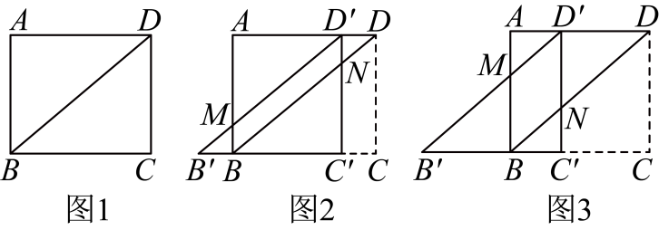

# Mathematics - 题目 1503

**ID**: 03859315680944bd86337b70d483bcd9
**年级**: Grade 9
**难度**: Medium-Hard
**题型**: Calculation

## 题目
综合与探究问题情境：如图，在矩形 $ABCD$ 中， $AD=8，AB=6$ ，将矩形 $ABCD$ 沿对角线 $BD$ 剪开，再将 $\mathrm{△}BCD$ 沿 $DA$ 方向平移（平移距离小于8），得到 $\vartriangle B^{′}C^{′}D^{′}，B^{′}D^{′}$ 交 $AB$ 于点 $M，C^{′}D^{′}$ 交 $BD$ 于点 $N$ ．初步探究：（1）如图2，当四边形 $ABC^{′}D^{′}$ 为正方形时，线段 $DD^{′}$ 的长为．（2）判断四边形 $BMD^{′}N$ 的形状，并说明理由．（3）深入探究：如图3，当四边形 $BMD^{′}N$ 是菱形时．①求线段 $DD^{′}$ 的长；​​​​​​​‌②将 $\vartriangle B{^{\prime }}C{^{\prime }}D{^{\prime }}$ 绕点 $D^{′}$ 顺时针转过一定的角度，使得线段 $B^{′}D^{′}$ 经过 $\vartriangle ADB$ 一个顶点且 $\vartriangle B{^{\prime }}C{^{\prime }}D{^{\prime }}$ 与 $\mathrm{△}ABD$ 有重叠部分，直接写出重叠部分的面积．

## 解答

1. （1）解：∵四边形 $ABC^{′}D^{′}$ 为正方形，
2. ∴ $AD^{′}=AB=6$ ，
3. ∴ $DD^{′}=AD-AD^{′}=8-6=2$ .
4. （2）四边形 $BMD^{′}N$ 是平行四边形．
5. 理由： $\because $ 四边形 $ABCD$ 是矩形，
6. $\therefore CD\mathrm{/\mskip-4mu/}AB$ ．
7. 由平移的性质得 $C^{′}D^{′}/\mskip-4mu/CD，B^{′}D^{′}/\mskip-4mu/BD$ ，
8. $\therefore C^{′}D^{′}/\mskip-4mu/AB$ ，
9. $\therefore $ 四边形 $BMD^{′}N$ 是平行四边形．
10. （3）① $\because $ 四边形 $BMD^{′}N$ 是菱形，
11. $\therefore BM=MD^{′}=D^{′}N=BN$ ．
12. 设 $DD^{′}$ 的长为 $m$ ，则 $AD^{′}=AD-DD^{′}=8-m$ ．
13. 在 ${\rm{R}}{\rm{t}}△ABD$ 中， $AD=8，AB=6$ ，
14. $\therefore BD=10$ ，
15. $\therefore {\rm{t}}{\rm{a}}{\rm{n}}∠ADB=\frac {3}{4}，{\rm{s}}{\rm{i}}{\rm{n}}∠ADB=\frac {3}{5}，{\rm{c}}{\rm{o}}{\rm{s}}∠ADB=\frac {4}{5}$ ，
16. $\therefore D^{′}N=DD^{′}{\cdot }{\rm{t}}{\rm{a}}{\rm{n}}∠ADB=\frac {3}{4}m$ ．
17. 在 ${\rm{R}}{\rm{t}}△AMD^{′}$ 中， $D^{′}M=\frac {AD^{′}}{{\rm{c}}{\rm{o}}{\rm{s}}\angle AD^{′}M}=\frac {5\times \left ({8-m}\right )}{4}$ ，
18. $\therefore \frac {3}{4}m=\frac {5\times \left ({8-m}\right )}{4}$ ，解得 $m=5$ ，
19. $\therefore DD^{′}=5$ ．
20. ②6或 $\frac {90}{11}$ ．
21. 如图1，当线段 $B^{′}D^{′}$ 经过点 $\mathrm{A}$ 时，令 $AB$ 与 $C{^{\prime }}D{^{\prime }}$ 的交点为 $P$ ．
22. 
23. 由①知， $DD^{′}=5$ ，
24. $\therefore AD^{′}=3$
25. ∴ $AP=AD^{′}{\cdot }{\rm{t}}{\rm{a}}{\rm{n}}∠B^{′}D^{′}C^{′}=3\times \frac {4}{3}=4$ ，
26. $\therefore S{{}_{\vartriangle AD^{′}P}}=\frac {1}{2}AD^{′}{\cdot }AP=\frac {1}{2}\times 3\times 4=6$ ；
27. 如图2，当线段 $B^{′}D^{′}$ 经过点 $B$ 时，令 $BD$ 与 $C{^{\prime }}D{^{\prime }}$ 的交点为 $Q$ ．过点 $D^{′}$ 作 $D^{′}E\bot BD$ 于点 $E$ ，过点 $Q$ 作 $QH\bot B^{′}D^{′}$ 于点 $H$ ．
28. 
29. $D^{′}E=DD^{′}{\cdot }{\rm{s}}{\rm{i}}{\rm{n}}D=5\times \frac {3}{5}=3，$
30. $\therefore AD^{′}=D^{′}E$ ，
31. $\therefore ∠ABD^{′}=∠EBD^{′}$ ．
32. $\because ∠A=∠BHQ=90{^{\circ }}$ ，
33. $\therefore \vartriangle ABD{^{{\rm{^{′}}}}}∽\vartriangle HBQ$ ，
34. $\therefore \frac {HQ}{BH}=\frac {AD^{′}}{AB}=\frac {3}{6}=\frac {1}{2}$ ．
35. 设 $HQ$ 的长为 $b$ ，则 $D^{′}H=\frac {HQ}{{\rm{t}}{\rm{a}}{\rm{n}}∠HD^{′}Q}=\frac {3}{4}b，BH=2b$ ，
36. $\therefore BD^{′}=BH+HD^{′}=2b+\frac {3}{4}b=\frac {11}{4}b$ ．
37. 在 ${\rm{R}}{\rm{t}}\mathrm{△}ABD^{′}$ 中，由勾股定理得 $BD^{′}=\sqrt {AB{^{2}}+AD{^{{\rm{^{′}}}2}}}=3\sqrt {5}$ ，
38. $\therefore \frac {11}{4}b=3\sqrt {5}$ ，
39. 解得 $b=\frac {12\sqrt {5}}{11}$ ，
40. $\therefore S{{}_{\vartriangle BD^{′}Q}}=\frac {1}{2}BD^{′}{\cdot }HQ=\frac {1}{2}\times 3\sqrt {5}\times \frac {12\sqrt {5}}{11}=\frac {90}{11}$ ．
41. 综上所述，重叠部分的面积为6或 $\frac {90}{11}$ ．

## 知识点

**中文**:
  - 平移的性质
  - 相似三角形的判定与性质综合
  - 解直角三角形

**English**:
  - Properties of Translation
  - Determination and Properties
  - Solving Right Triangles

---
