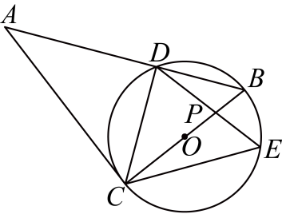

# Mathematics - 题目 962

**ID**: 049197e958dd436380c0bd1f00dc44d8
**年级**: Grade 9
**难度**: Medium-Hard
**题型**: Calculation

## 题目
如图，在 $\vartriangle ABC$ 中， $\angle ACB\mathrm{=}90{}\degree $ ，以 $BC$ 为直径的⊙ $O$ 交 $AB$ 于点 $D$ ，点 $E$ 在⊙ $O$ 上，连接 $BE,CE,DE,BC$ 交 $DE$ 于点 $P$ ．（1）求证： $\angle BED=\angle A$ ；​​​​​​​‌（2）若 $BE=PE,AC=20,CP=12$ ，①求 $DP$ 的长；②求 ${\rm{t}}{\rm{a}}{\rm{n}}∠BCE$ 的值．

## 解答

1. （1） $\because BC$ 为直径，
2. $\therefore \angle BDC=90{}\degree $ ，
3. $\therefore \angle BCD+\angle CBD=90{}\degree $ ，
4. $\because \angle ACB=90{}\degree $ ，
5. $\therefore \angle CBD+\angle A=90{}\degree $ ，
6. $\therefore \angle A=\angle BCD$ ，
7. $\because \overset{\frown}{{BD}}=\overset{\frown}{{BD}}$ ，
8. $\therefore ∠BED=∠BCD$ ，
9. $\therefore \angle BED=\angle A$
10. （2）过点 $D$ 作 $DF\bot BC$ 于点 $F$ ，
11. 
12. ， $\because ∠BED=∠BCD，∠BPE=∠DPC$ ，
13. $\therefore \vartriangle BEP∽\vartriangle DCP$ ．
14. $\therefore \frac {BE}{DC}=\frac {PE}{PC}=\frac {BP}{DP}$ ，
15. $\because BE=PE$ ，
16. $\therefore DC=PC=12$ ，
17. $\because DF\bot BC$ ，
18. $\therefore \angle DFC=90{}\degree $ ，
19. $\because \angle CDA=90{}\degree $ ，
20. $\therefore ∠DFC=∠CDA$ ，
21. $\because \angle A=\angle BCD$ ，
22. $\therefore \vartriangle DFC∽\vartriangle CDA$ ．
23. $\therefore \frac {DF}{CD}=\frac {CD}{AC}$ ，
24. $\therefore \frac {DF}{12}=\frac {12}{20}$ ，
25. $\therefore DF=\frac {36}{5}$ ，
26. 在 ${\rm{R}}{\rm{t}}\mathrm{△}CDF$ 中
27. $\therefore CF=\sqrt {CD{^{2}}-DF{^{2}}}=\sqrt {12{^{2}}-{\left({\frac {36}{5}}\right)^{2}}}=\frac {48}{5}$ ，
28. $\therefore PF=CP-CF=12-\frac {48}{5}=\frac {12}{5}$ ，
29. 在 ${\rm{R}}{\rm{t}}\vartriangle PDF$ 中
30. $\therefore DP=\sqrt {PF{^{2}}+DF{^{2}}}=\sqrt {{\left({\frac {12}{5}}\right)^{2}}+{\left({\frac {36}{5}}\right)^{2}}}=\frac {12}{5}\sqrt {10}$ ，
31. ② $\because \angle DFC=\angle CDB=90{}\degree ，\angle DCF=\angle BCD$ ，
32. $\therefore \vartriangle DFC∽\vartriangle BDC$ ．
33. $\therefore \frac {CD}{CB}=\frac {CF}{CD}$ ，
34. $\therefore \frac {12}{CB}=\frac {\frac {48}{5}}{12}$ ，
35. $\therefore CB=15$ ，
36. $\therefore BP=CB-CP=3$ ，
37. $\because \frac {BE}{DC}=\frac {BP}{DP}$ ，
38. $\therefore \frac {BE}{12}=\frac {3}{\frac {12}{5}\sqrt {10}}$ ，
39. $\therefore BE=\frac {3}{2}\sqrt {10}$ ，
40. 在 ${\rm{R}}{\rm{t}}\vartriangle BCE$ 中
41. $\therefore CE=\sqrt {BC{^{2}}-BE{^{2}}}=\sqrt {15{^{2}}-{\left({\frac {3}{2}\sqrt {10}}\right)^{2}}}=\frac {9}{2}\sqrt {10}$ ，
42. $\therefore {\rm{t}}{\rm{a}}{\rm{n}}∠BCE=\frac {\frac {3}{2}\sqrt {10}}{\frac {9}{2}\sqrt {10}}=\frac {1}{3}$ ．

## 知识点

**中文**:
  - 同弧或等弧所对的圆周角相等
  - 相似三角形的判定与性质综合
  - 正切

**English**:
  - Angles Subtended by Same Arc are Equal
  - Determination and Properties
  - Tangent

---
