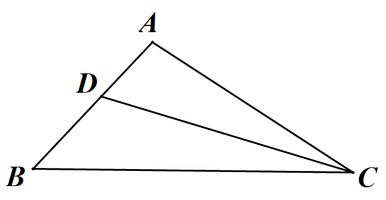

# Mathematics - 题目 831

**ID**: 05f4f3050e2d48e49bf8861e6baaae6a
**年级**: Grade 9
**难度**: Medium-Hard
**题型**: Calculation

## 题目
已知： $\vartriangle ABC$ ，CD平分 $\angle ACB$ ．求作：菱形DFCE，使点F在BC边上，点E在AC边上，下面是尺规作图过程．作法：①分别以C、D为圆心，大于 $\frac {1}{2}CD$ 为半径作弧，两弧分别交于点M、N；​​​​​​​‌②作直线MN分别与AC、BC交于点E、F；③连接DE、DF，DC与EF的交点记为点G；四边形DFCE为所求作的菱形．（1）利用直尺和圆规依做法补全图形（保留作图痕迹）；（2）完成下面的证明．证明： $\because DE=EC,DF=FC$ ，$\therefore EF$ 为DC的垂直平分线．$\because DE=E{\rm{C}}$ ，$\therefore \angle EDC=\angle ECD$ ．$\because CD$ 平分 $\angle ACB$ ，$\therefore \angle ECD=\angle DCB$ ．$\therefore \angle EDC=\angle DCB$ ，$\therefore $$//$ （    ）（填推理依据）同理可证 $EF//CE$ ，$\therefore $ 四边形DFCE为平行四边形．又 $\because $，$\therefore $ 四边形DFCE为菱形．

## 解答

1. （1）根据题目作法可以得到下面图形：
2. 
3. 其中四边形DFCE为所求作的菱形；
4. （2）证明： $\because DE=EC,DF=FC$ ，
5. $\therefore EF$ 为DC的垂直平分线．
6. $\because DE=E{\rm{C}}$ ，
7. $\therefore \angle EDC=\angle ECD$ ．
8. $\because CD$ 平分 $\angle ACB$ ，
9. $\therefore \angle ECD=\angle DCB$ ．
10. $\therefore \angle EDC=\angle DCB$ ，
11. $\therefore $DE$//$FC（ 内错角相等，两直线平行  ）（填推理依据）
12. 同理可证 $DF//CE$ ，
13. $\therefore $ 四边形DFCE为平行四边形．
14. 又 $\because $  ${\underline{DE=EC}}$ ，
15. $\therefore $ 四边形DFCE为菱形．
16. 故答案为DE；FC；内错角相等，两直线平行；DE=EC（或DF=FC）．

## 知识点

**中文**:
  - 菱形的判定与性质综合

**English**:
  - Determination and Properties of Rhombuses

---
