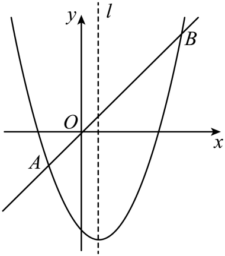

# Mathematics - 题目 2788

**ID**: 0649c748865647658dbd3d8aae7d8bff
**年级**: Grade 9
**难度**: Medium-Hard
**题型**: Calculation

## 题目
综合与探究如图，抛物线 $y=x{^{2}}+bx+c$ 经过点 $A\left ({-1,-1}\right )$ 和点 $B\left ({3,3}\right )$ ，点 $P$ 是线段 $AB$ 上一动点（不与 $A,B$ 重合），直线 $l$ 是抛物线的对称轴，设点 $P$ 的横坐标为 $m$ ．(1)求抛物线的函数表达式及直线 $AB$ 的函数表达式．(2)当点 $P$ 在直线 $l$ 右侧的线段部分上运动时，过点 $P$ 作 $x$ 轴的垂线交抛物线于点 $Q$ ，分别过点 $P，Q$ 作直线 $l$ 的垂线，垂足分别为 $C，D$ ，求四边形 $PCDQ$ 周长的最大值．(3)若点 $E$ 是抛物线上一点，平面内是否存在点 $F$ ，使得以点 $A，E，F，P$ 为顶点的四边形是正方形时，若存在，请直接写出所有满足条件的点 $F$ 的坐标．若不存在，请说明理由．​​​​​​​‌

## 解答

1. （1）解：将点 $A\left ({-1,-1}\right )$ 和点 $B\left ({3,3}\right )$ 代入 $y=x{^{2}}+bx+c$ 得
2. $\begin{cases}1-b+c=-1\\9+3b+c=3\end{cases}$ ，
3. 解得 $\begin{cases}b=-1\\c=-3\end{cases}$ ，
4. ∴抛物线的函数表达式为 $y=x{^{2}}-x-3$ ，
5. 设直线 $AB$ 的函数表达式为 $y=kx+n$ ，
6. ∴ $\begin{cases}-k+n=-1\\3k+n=3\end{cases}$ ，
7. 解得 $\begin{cases}k=1\\n=0\end{cases}$ ，
8. ∴直线 $AB$ 的函数表达式为 $y=x$ ；
9. （2）解：∵ $y=x{^{2}}-x-3={\left({x-\frac {1}{2}}\right)^{2}}-\frac {13}{4}$ ，
10. ∴抛物线的对称轴为直线 $x=\frac {1}{2}$ ，
11. 
12. ∵点 $P$ 的横坐标为 $m$ ，
13. ∴点 $P$ 的坐标为 $\left ({m，m}\right )$ ，点 $Q$ 的坐标为 $\left ({m，m{^{2}}-m-3}\right )$ ，
14. ∴ $CD=PQ=m-m{^{2}}+m+3=-m{^{2}}+2m+3$ ， $PC=QD=m-\frac {1}{2}$ ，
15. ∴四边形 $PCDQ$ 周长为 $2\left ({-m{^{2}}+2m+3+m-\frac {1}{2}}\right )=-2m{^{2}}+6m+5$ ，
16. ∵ $-2<0$ ，
17. ∴当 $m=-\frac {6}{2\times \left ({-2}\right )}=\frac {3}{2}$ 时，四边形 $PCDQ$ 周长有最大值，
18. 最大值为 $-2\times {\left({\frac {3}{2}}\right)^{2}}+6\times \left ({\frac {3}{2}}\right )+5=\frac {19}{2}$ ；
19. （3）解：当 $AEPF$ 为正方形时，如图，
20. 
21. ∵点 $A\left ({-1,-1}\right )$ 和点 $B\left ({3,3}\right )$ ，
22. ∴ $\angle BAE=45{}^\circ $ ，
23. ∵点 $E$ 与点 $A\left ({-1,-1}\right )$ 关于对称轴 $x=\frac {1}{2}$ 对称，
24. ∴点 $E\left ({2,-1}\right )$ ，
25. ∴点 $P\left ({2,2}\right )$ ，
26. ∴点 $F$ 的坐标为 $\left ({-1,2}\right )$ ；
27. 当 $APFE$ 为正方形时，如图，设正方形的中心为点 $G$ ，
28. 
29. ∵ $\angle PAG=45{}^\circ $ ， $\angle PAE=90{}^\circ $ ，
30. ∴ $PE/\mskip-4mu/y$ ，
31. ∴点 $P$ 的坐标为 $\left ({m，m}\right )$ ，点 $E$ 的坐标为 $\left ({m，m{^{2}}-m-3}\right )$ ，
32. ∴ $PG=m+1$ ， $GE=-1-m{^{2}}+m+3=-m{^{2}}+m+2$ ，
33. ∵ $PG=GE$ ，
34. ∴ $-m{^{2}}+m+2=m+1$ ，即 $m{^{2}}=1$ ，解得 $m=\pm 1$ ，
35. ∴点 $P$ 的坐标为 $\left ({1，1}\right )$ ，点 $G$ 的坐标为 $\left ({1，-1}\right )$ ，
36. ∴点 $F$ 的坐标为 $\left ({3,-1}\right )$ ；
37. 当 $APEF$ 为正方形时，如图，设正方形的中心为点 $G$ ，
38. 
39. 显然点 $E$ 与点 $A\left ({-1,-1}\right )$ 关于对称轴 $x=\frac {1}{2}$ 对称，
40. ∴点 $F$ 的坐标为 $\left ({\frac {1}{2},-\frac {5}{2}}\right )$ ；
41. 综上，点 $F$ 的坐标为 $\left ({\frac {1}{2},-\frac {5}{2}}\right )$ 或 $\left ({3,-1}\right )$ 或 $\left ({-1,2}\right )$ ．

## 知识点

**中文**:
  - 二次函数的对称
  - 二次函数的最值
  - 二次函数的综合

**English**:
  - Symmetry of Quadratic Functions
  - Maximum/Minimum of Quadratic Functions
  - Comprehensive Quadratic Function Problems

---
