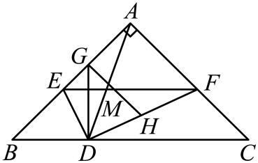

# Mathematics - 题目 1501

**ID**: 065de3a40b0d45739a9afdf929ea17a6
**年级**: Grade 9
**难度**: Medium-Hard
**题型**: Calculation

## 题目
如图，在 $\vartriangle ABC$ 中， $\angle BAC=90{}\degree ，AB=AC$ ，点D是边 $BC$ 上一动点（不与B，C重合），点E在边 $AB$ 上，且 $\angle ADE=45{}\degree $ ，将 $\vartriangle DBE$ 绕点D顺时针旋转得到 $\vartriangle DGH$ ，且点B的对应点G恰好落在边 $AB$ 上， $DH$ 的延长线交 $AC$ 于点F，连接 $EF$ ，交 $AD$ 于点M．(1)求 $\angle ADF$ 的度数；​​​​​​​‌(2)求证： $\frac {EM}{GD}=\frac {MF}{DC}$ ；(3) $\frac {BE}{CD}+\frac {FM}{AE}$ 的值是否为定值？若是，求出该定值；若不是，请说明理由．

## 解答

1. （1）解： $\because \angle BAC=90{}\degree $ ， $AB=AC$ ，
2. $\therefore \angle B=45{}\degree $ ，
3. 由旋转的性质可知， $BD=GD$ ，
4. $\therefore △BGD$ 为等腰直角三角形，
5. $\therefore $ 旋转角 $\angle BDG=90{}\degree $ ，
6. $\therefore $ 旋转角 $\angle EDF=90{}\degree $ ，
7. $\therefore \angle ADF=90{}\degree -\angle ADE=45{}\degree $ ；
8. （2）证明： $\because \angle EAF=90{}\degree $ ，
9. $\therefore \vartriangle AEF$ 的外接圆是以 $EF$ 为直径的圆，
10. $\because \angle EDF=90{}\degree $ ，
11. $\therefore \vartriangle DEF$ 的外接圆是以 $EF$ 为直径的圆，
12. $\therefore A$ ， $E$ ， $D$ ， $F$ 共圆，
13. $\therefore \angle AEF=\angle ADF=45{}\degree $ ，
14. $\therefore \angle AEF=\angle B=45{}\degree $ ，
15. $\therefore EF\parallel BC$ ，
16. $\therefore $  $\frac {EM}{BD}=\frac {AE}{AB}=\frac {AM}{AD}=\frac {FM}{CD}=\frac {AF}{AC}$ ，
17. $\because BD=DG$ ，
18. $\therefore $  $\frac {EM}{GD}=\frac {FM}{CD}$ ；
19. （3）解：是定值；
20. 证明如下：设 $\frac {EM}{BD}=\frac {AE}{AB}=\frac {AM}{AD}=\frac {FM}{CD}=\frac {AF}{AC}=k$ ，
21. $\therefore AE=kAB$ ， $FM=kCD$ ，
22. $\therefore BE=(1-k)AB$ ，
23. $\therefore $  $\frac {BE}{CD}+\frac {FM}{AE}=\frac {(1-k)AB}{CD}+\frac {kCD}{kAB}$ ，
24. $\because \angle ADE=\angle B=45{}\degree $ ， $\angle DAE=\angle BAD$ ，
25. $\therefore \vartriangle ADE∽\vartriangle ABD$ ，
26. $\therefore AD{^{2}}=AE\cdot AB=kAB{^{2}}$ ，
27. $\therefore AD=\sqrt {k}AB$ ，
28. 过作 $AN\bot BC$ 于 $N$ ，如图：
29. $\therefore AN=BN=CN=\frac {\sqrt {2}}{2}AB$ ，
30. $\therefore DN=\sqrt {AD{^{2}}-AN{^{2}}}=\sqrt {k-\frac {1}{2}}AB$ ，
31. $\therefore CD=(\frac {\sqrt {2}}{2}\pm \sqrt {k-\frac {1}{2}})AB$ ，
32. $\therefore $  $\frac {BE}{CD}+\frac {FM}{AE}$
33. $=(1-k)\cdot \frac {1}{\frac {\sqrt {2}}{2}\pm \sqrt {k-\frac {1}{2}}}+\frac {\sqrt {2}}{2}\pm \sqrt {k-\frac {1}{2}}$
34. $=\frac {1-k+(\frac {\sqrt {2}}{2}\pm \sqrt {k-\frac {1}{2}}){^{2}}}{\frac {\sqrt {2}}{2}\pm \sqrt {k-\frac {1}{2}}}$
35. $=\frac {1-k+\frac {1}{2}+k-\frac {1}{2}\pm \sqrt {2}\cdot \sqrt {k-\frac {1}{2}}}{\frac {\sqrt {2}}{2}\pm \sqrt {k-\frac {1}{2}}}$
36. $=\frac {\sqrt {2}\times (\frac {\sqrt {2}}{2}\pm \sqrt {k-\frac {1}{2}})}{\frac {\sqrt {2}}{2}\pm \sqrt {k-\frac {1}{2}}}$
37. $=\sqrt {2}$ ．

## 知识点

**中文**:
  - 三角形的外接圆
  - 旋转的性质
  - 相似三角形的判定与性质综合
  - 等腰直角三角形的性质

**English**:
  - Circumcircle of Triangle
  - Properties of Rotation
  - Determination and Properties
  - Properties of Isosceles Right Triangles

---
