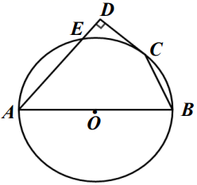

# Mathematics - 题目 1554

**ID**: 07463c6cee8449eaa0937afc4c068e71
**年级**: Grade 9
**难度**: Medium-Hard
**题型**: Calculation

## 题目
如图，四边形 $ABCD$ 中， $\angle D=90{}^\circ ,\quad \angle A+2\angle B=180{}^\circ $ ，以 $AB$ 为直径画 $\odot O$ 恰好经过点C，与 $AD$ 交于点E．（1）求证： $CD$ 与 $\odot O$ 相切；​​​​​​​‌（2）若 $AE=4DE$ ，求 ${\tan}B$ ．

## 解答

1. （1）连接OC，
2. ∵OC＝OB，
3. ∴∠B=∠OCB，
4. ∴∠COB+∠B+∠OCB=180°，
5. 即∠COB+2∠B=180°，
6. ∵∠DAB+2∠B=180°，
7. ∴∠DAB=∠COB，
8. ∴OC∥AD，
9. ∴∠OCD=∠D，
10. ∵∠D=90°，
11. ∴∠OCD=90°，
12. ∴ ${\rm CD}$ 与 ${\rm \odot O}$ 相切；
13. （2）如图，连接AC，EC，
14. ∵四边形AECB是圆的内接四边形，
15. ∴∠DEC=∠B，
16. ∵AB是直径，
17. ∴∠ACB=90°，
18. ∴∠B=90°-∠CAB，
19. ∵∠DCA=90°-∠ACO，∠CAB=∠ACO，
20. ∴∠B=∠DCA，
21. ∴∠DEC=∠DCA，
22. ∴△DEC∽△DCA，
23. ∴DC：DA=DE：DC，
24. ∴ ${\rm DC{^{2}}=DE\cdot DA=DE\cdot (DE+AE)=5DE{^{2}}}$ ，
25. ∴DC= $\sqrt {5}$DE；
26. ∵∠DAB=∠COB，∠DAB=∠DAC+∠OAC，∠COB=2∠OAC，
27. ∴∠DAC=∠OAC，
28. ∵∠ADC=∠ACB=90°，
29. ∴△DAC∽△CAB，
30. ∴AC：BC=AD：DC，
31. ∴ ${\rm {\tan}B}$ =AC：BC=AD：DC=5DE： $\sqrt {5}$DE= $\sqrt {5}$ ．
32. 

## 知识点

**中文**:
  - 切线的性质和判定的综合应用
  - 相似三角形的判定
  - 正切
  - 圆内接四边形

**English**:
  - Tangent Applications
  - Determination of Similar Triangles
  - Tangent
  - Cyclic Quadrilaterals

---
