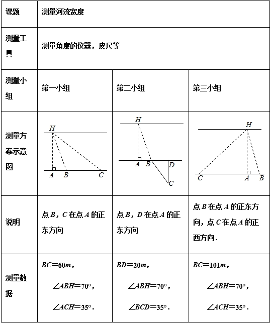
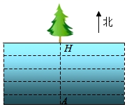

# Mathematics - 题目 1872

**ID**: 08faef009d0e48289f228f42dc326d48
**年级**: Grade 9
**难度**: Medium-Hard
**题型**: Calculation

## 题目
为了测量一条两岸平行的河流宽度，三个数学研究小组设计了不同的方案，他们在河南岸的点A处测得河北岸的树H恰好在A的正北方向．测量方案与数据如下表：（1）哪个小组的数据无法计算出河宽？（2）请选择其中一个方案及其数据求出河宽（精确到0.​​​​​​​‌1m）．（参考数据：sin70°≈0.94，sin35°≈0.57，tan70°≈2.75，tan35°≈0.70）

## 解答

1. 解：（1）第二个小组的数据无法计算河宽；
2. （2）第一个小组的解法：
3. ∵∠ABH＝∠ACH+∠BHC，∠ABH＝70°，∠ACH＝35°，
4. ∴∠BHC＝∠BCH＝35°，
5. ∴BC＝BH＝60m，
6. ∴AH＝BH•sin70°＝60×0.94≈56.4（m）．
7. 第三个小组的解法：
8. 设AH＝xm，则CA＝ $\frac {{\rm{A}}{\rm{H}}}{{\tan}35^\circ }$ ，AB＝ $\frac {{\rm{A}}{\rm{H}}}{{\tan}70^\circ }$ ，
9. ∵CA+AB＝CB，
10. ∴ $\frac {x}{0.70}+\frac {x}{2.75}$ ＝101，
11. 解得x≈56.4．
12. 答：河宽为56.4m．

## 知识点

**中文**:
  - 等腰三角形的判定与性质
  - 解直角三角形的实际应用

**English**:
  - Determination and Properties
  - Applications of Solving Right Triangles

---
