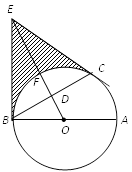

# Mathematics - 题目 3954

**ID**: 09018395ce5742ea8dbe6632d8f6cb15
**年级**: Grade 9
**难度**: Medium-Hard
**题型**: Calculation

## 题目
如图，AB是⊙O的直径，C是⊙O上一点， $OD\bot BC$ 于点D，过点C作⊙O的切线，交OD的延长线于点E，连结BE．（1）求证：BE是⊙O的切线；​​​​​​​‌（2）设OE交⊙O于点F，若 $DF=2，BC=4\sqrt {3}$ ，求线段EF的长；（3）在（2）的条件下，求阴影部分的面积．

## 解答

1. （1）证明：连接OC，如图，
2. ∵OD⊥BC，
3. ∴CD=BD，
4. ∴OE为BC的垂直平分线，
5. ∴EB=EC，
6. ∴∠EBC=∠ECB，
7. ∵OB=OC，
8. ∴∠OBC=∠OCB，
9. ∴∠OBC+∠EBC=∠OCB+∠ECB，即∠OBE=∠OCE，
10. ∵CE为⊙O的切线，
11. ∴OC⊥CE，
12. ∴∠OCE=90°，
13. ∴∠OBE=90°，
14. ∴OB⊥BE，
15. ∴BE与⊙O相切．
16. （2）设⊙O的半径为R，则OD=R-DF=R-2，OB=R，
17. 在Rt△OBD中，BD= $\frac {1}{2}$ BC= $2\sqrt {3}$
18. ∵OD^{2}+BD^{2}=OB^{2}，
19. ∴ $(R-2){^{2}}+(2\sqrt {3}){^{2}}=R{^{2}}$ ，解得R=4，
20. ∴OD=2，OB=4，
21. ∴∠OBD=30°，
22. ∴∠BOD=60°，
23. ∴在Rt△OBE中，∠BEO=30º，OE=2OB=8，
24. ∴EF=OE-OF=8-4=4，
25. 即EF=4；
26. （3）由∠OCD=∠OBD=30º和OD⊥BC知：∠COD=∠BOD=60º，
27. ∴∠BOC=120º，又BC= $4\sqrt {3}$ ，OE=8，
28. ∴ $S{{}_{阴影}}{\rm{=}}{\rm{S}}{{}_{四边形OBEC}}-S{{}_{扇形OBC}}$
29. = $\frac {1}{2}\times 8\times 4\sqrt {3}-\frac {120π\centerdot 4{^{2}}}{360}$
30. $=16\sqrt {3}-\frac {16}{3}π$ ,
31. 

## 知识点

**中文**:
  - 切线的性质和判定的综合应用
  - 含30度角的直角三角形
  - 垂径定理的应用
  - 扇形面积的计算

**English**:
  - Tangent Applications
  - Right Triangle with 30° Angle
  - Applications of Perpendicular Chord Theorem
  - Sector Area Calculation

---
