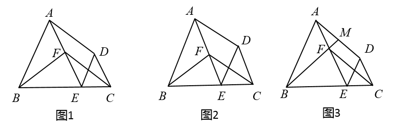

# Mathematics - 题目 2726

**ID**: 0a94ef1849394245beb8a40d131780bb
**年级**: Grade 9
**难度**: Medium-Hard
**题型**: Calculation

## 题目
如图1，在四边形ABCD中， $\angle ABC=\angle BCD$ ，点E在边BC上，且 $AE//CD$ ， $DE//AB$ ，作 $\mathrm{C}\mathrm{F}\mathrm{/}\mathrm{/}\mathrm{A}\mathrm{D}$ 交线段AE于点F，连接BF．（1）求证： $△ABF≌△EAD$ ；​​​​​​​‌（2）如图2，若 $AB=9$ ， $CD=5$ ， $\angle ECF=\angle AED$ ，求BE的长；（3）如图3，若BF的延长线经过AD的中点M，求 $\frac {BE}{EC}$ 的值．

## 解答

1. （1）证明： $\because AE//CD$ ，
2. $\therefore \angle AEB=\angle DCE$ ；
3. $\because DE//AB$ ，
4. $\therefore \angle ABE=\angle DEC$ ， $\angle 1=\angle 2$ ，
5. $\because \angle ABC=\angle BCD$ ，
6. $\therefore \angle ABE=\angle AEB$ ， $\angle DCE=\angle DEC$ ，
7. $\mathrm{∴}AB=AE$ ， $DE=DC$ ，
8. $\because AF//CD$ ， $AD//CF$ ，
9. $\therefore $ 四边形AFCD是平行四边形
10. $\therefore AF=CD$
11. $\therefore AF=DE$
12. 在 $\vartriangle ABF$ 与 $\vartriangle EAD$ 中．
13. $\begin{cases}AB=EA\\\angle 1=\angle 2\\AF=ED\end{cases}$ ，
14. $\therefore △ABF≌△EAD(SAS)$
15. 
16. （2） $\because \mathrm{△}ABF≌\mathrm{△}EAD$ ，
17. $\therefore BF=AD$ ，
18. 在 $□AFCD$ 中， $AD=CF$ ，
19. $\therefore BF=CF$ ，
20. $\therefore \angle FBC=\angle FCB$ ，
21. 又 $\because \angle FCB=\angle 2$ ， $\angle 2=\angle 1$ ，
22. $\therefore \angle FBC=\angle 1$ ，
23. 在 $\mathrm{△}EBF$ 与 $\vartriangle EAB$ 中．
24. $\begin{cases}\angle EBF=\angle 1\\\angle BEF=\angle AEB\end{cases}$ ，
25. $\therefore △EBF∽△EAB$ ；
26. $\therefore \frac {EB}{EA}=\frac {EF}{EB}$ ；
27. $\because AB=9$ ，
28. $\therefore AE=9$ ；
29. $\because CD=5$ ，
30. $\therefore AF=5$ ；
31. $\therefore EF=4$ ，
32. $\therefore \frac {EB}{9}=\frac {4}{EB}$ ，
33. $\therefore BE=6$ 或 $-6$ （舍）；
34. （3）延长BM、ED交于点G．
35. 
36. $\because \vartriangle ABE$ 与 $\vartriangle DCE$ 均为等腰三角形， $\angle ABC=\angle DCE$ ，
37. $\therefore △ABE∽△DCE$ ，
38. $\therefore \frac {AB}{DC}=\frac {AE}{DE}=\frac {BE}{CE}$ ，
39. 设 $CE=1$ ， $BE=x$ ， $DC=DE=a$ ，
40. 则 $AB=AE=ax$ ， $AF=CD=a$ ，
41. $\therefore EF=a(x-1)$ ，
42. $\because AB//DG$ ，
43. $\therefore \angle 3=\angle G$ ；
44. 在 $△MAB$ 与 $\vartriangle MDG$ 中，
45. $\begin{cases}\angle 3=\angle G\\\angle 4=\angle 5\\MA=MD\end{cases}$ ，
46. $\therefore △MAB≌△MDG(AAS)$ ；
47. $\therefore DG=AB=ax$ ．
48. $\therefore EG=a(x+1)$ ；
49. $\because AB//EG$ ，
50. $\therefore △FAB∽△FEG$ ，
51. $\therefore \frac {FA}{FE}=\frac {AB}{EG}$ ，
52. $\therefore \frac {a}{a(x-1)}=\frac {ax}{a(x+1)}$ ，
53. $\therefore x(x-1)=x+1$ ，
54. $\therefore x{^{2}}-2x-1=0$ ，
55. $\therefore (x-1){^{2}}=2$ ，
56. $\therefore x=1\pm \sqrt {2}$ ，
57. $\therefore x{{}_{1}}=1-\sqrt {2}$ （舍）， $x{{}_{2}}=1+\sqrt {2}$ ，
58. $\therefore \frac {BE}{EC}=1+\sqrt {2}$ ．

## 知识点

**中文**:
  - 三角形的综合

**English**:
  - Comprehensive Triangle Problems

---
