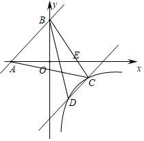

# Mathematics - 题目 3110

**ID**: 0aff7c9884004db7a9c5ef00c92062b3
**年级**: Grade 9
**难度**: Medium-Hard
**题型**: Calculation

## 题目
如图所示，一次函数y＝x+3与x轴、y轴分别交于点A、B，将直线AB向下平移与反比例函数 $y=\frac {m}{x}$ （x＞0）交于点C、D，连接BC交x轴于点E，连接AC，已知BE＝3CE，且S_{△ACE}＝ $\frac {9}{4}$ ．（1）求直线BC和反比例函数解析式；​​​​​​​‌（2）连接BD，求△BCD的面积．

## 解答

1. （1）作CF⊥x轴于F，
2. 由直线y＝x+3可知，A（﹣3，0），B（0，3），
3. ∵BE＝3CE，且S_{△ACE}＝ $\frac {9}{4}$ ，
4. ∴S_{△ABE}＝ $\frac {27}{4}$ ，
5. ∴ $\frac {1}{2}$  AE•OB＝ $\frac {27}{4}$ ，即 $\frac {1}{2}$ AE•3＝ $\frac {27}{4}$ ，
6. ∴AE＝ $\frac {9}{2}$ ，
7. ∴OE＝ $\frac {3}{2}$ ，
8. ∵S_{△ACE}＝ $\frac {1}{2}$ AE•CF＝ $\frac {9}{4}$ ，
9. ∴CF＝1，
10. ∵CF∥OB，
11. ∴△ECF∽△EBO，
12. ∴ $\frac {EF}{OE}=\frac {CF}{OB}$ ，即 $\frac {EF}{\frac {3}{2}}$  ＝ $\frac {1}{3}$ ，
13. ∴EF＝ $\frac {1}{2}$ ，
14. ∴OF＝OE+DF＝2，
15. ∴C（2，﹣1），
16. ∴BC＝ $\sqrt {2{^{2}}+{\left({-1-3}\right)^{2}}}=2\sqrt {5}$ ，
17. ∵反比例函数y＝ $\frac {m}{x}$  （x＞0）经过点C，
18. ∴m＝2×（﹣1）＝﹣2，
19. ∴反比例函数解析式为y＝﹣ $\frac {2}{x}$  ；
20. （2）∵将直线AB向下平移与反比例函数y＝ $\frac {m}{x}$ （x＞0）交于点C、D，
21. ∴设直线CD的解析式为y＝x+b，令直线CD交y轴于H，
22. 把C（2，﹣1）代入得，﹣1＝2+b，
23. ∴b＝﹣3，
24. ∴直线CD的解析式为y＝x﹣3，
25. ∴H（0，﹣3），
26. 解 $\begin{cases}y=x-3\\y=\frac {2}{x}\end{cases}得\begin{cases}x=2\\y=-1\end{cases}或\begin{cases}x=1\\y=-2\end{cases}$ ，
27. ∴D（1，﹣2），
28. ∴S_{△BCD}＝S_{△BCH}﹣S_{△BDH}＝ $\frac {1}{2}$  ×3×2﹣ $\frac {1}{2}$ ×3×1＝ $\frac {3}{2}$ ．
29. 

## 知识点

**中文**:
  - 反比例函数解析式
  - 坐标与图形性质
  - 待定系数法求一次函数解析式

**English**:
  - Analytic Expression of Inverse Proportionality
  - Coordinates and Geometric Properties
  - Finding Expressions by Undetermined Coefficients

---
