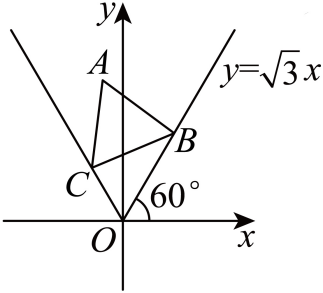

# Mathematics - 题目 86

**ID**: 0b8335c08c5b4458993ae14ed74f01b6
**年级**: Grade 9
**难度**: Medium-Hard
**题型**: Calculation

## 题目
在平面直角坐标系中，已知 $A\left ({x{{}_{1}},y{{}_{1}}}\right )$ ， $B\left ({x{{}_{2}},y{{}_{2}}}\right )$ ， $C\left ({x{{}_{3}},y{{}_{3}}}\right )$ ，那么可以得到线段 $BC$ 的中点 $M\left ({\frac {x{{}_{2}}+x{{}_{3}}}{2},\frac {y{{}_{2}}+y{{}_{3}}}{2}}\right )$ 和 $\vartriangle ABC$ 的重心 $G\left ({\frac {x{{}_{1}}+x{{}_{2}}+x{{}_{3}}}{3},\frac {y{{}_{1}}+y{{}_{2}}+y{{}_{3}}}{3}}\right )$ ．根据以上信息解决如下问题：如图所示， 等边 $\vartriangle ABC$ 的边长为 $2$ ， $M$ 是 $BC$ 的中点， $G$ 是 $\vartriangle ABC$ 的重心．顶点 $B$ 在射线 $l{{}_{1}}:y=\sqrt {3}x$ （ $y\geqslant 0$ ，射线与 $x$ 轴正方向所成夹角为 $60{}^\circ $ ）上，顶点 $C$ 在射线 $l{{}_{1}}$ 关于 $y$ 轴的对称射线 $l{{}_{2}}$ 上，顶点 $A$ 在边 $BC$ 的上方．(1)若设 $M\left ({x,y}\right )$ ，则求其横纵坐标 $x$ ， $y$ 满足的等量关系（不用写出 $x$ ， $y$ 的取值范围）．(2)若点B，C的横坐标分别为a，b；​​​​​​​‌①求出 $\left |{a-b}\right |$ 的取值范围；②求点B从原点开始运动时，当点C回到原点时，点G运动路径的长度．

## 解答

1. （1）解：∵ $l{{}_{1}}:y=\sqrt {3}x$ ， $l{{}_{1}}$ 与 $l{{}_{2}}$ 关于y轴对称，
2. ∴设 $l{{}_{1}}$ 上任意一点为 $\left ({m,\sqrt {3}m}\right )$ ，则 $\left ({-m,\sqrt {3}m}\right )$ 在 $l{{}_{2}}$ 上，
3. 设 $l{{}_{2}}:y=kx\left ({k\ne 0}\right )$ ，代入 $\left ({-m,\sqrt {3}m}\right )$ 得： $\sqrt {3}m=-km$ ，
4. 解得： $k=-\sqrt {3}$ ，
5. ∴ $l{{}_{2}}:y=-\sqrt {3}x$ ，
6. 设 $B\left ({b,\sqrt {3}b}\right )$ ， $C\left ({c,-\sqrt {3}c}\right )$ ，
7. 则 $M\left ({\frac {b+c}{2},\frac {\sqrt {3}b-\sqrt {3}c}{2}}\right )$ ，
8. ∵ $BC=\sqrt {{\left({b-c}\right)^{2}}+3{\left({b+c}\right)^{2}}}=2$ ，
9. 化简得： ${\left({b-c}\right)^{2}}+3{\left({b+c}\right)^{2}}=4$ ，
10. 而 $x{{}_{M}}=\frac {b+c}{2},y{{}_{M}}=\frac {\sqrt {3}\left ({b-c}\right )}{2}$ ，
11. ∴代入得： $12x{{}_{M}}{^{2}}+\frac {4}{3}y{{}_{M}}{^{2}}=4$ ，
12. ∴ $9x{{}_{M}}{^{2}}+y{{}_{M}}{^{2}}=3$ ，
13. 即： $9x{^{2}}+y{^{2}}=3$ ．
14. （2）解：由 $9x{{}_{M}}{^{2}}+y{{}_{M}}{^{2}}=3$ ，
15. 得 $9x{{}_{M}}{^{2}}=3-y{{}_{M}}{^{2}}\geqslant 0$ ，
16. ∴ $0\leqslant y{{}_{M}}\leqslant \sqrt {3}$ ，
17. 联立 $\begin{cases}9x{^{2}}+y{^{2}}=3\\y=\pm \sqrt {3}x\end{cases}$ ，解得： $x=\pm \frac {1}{2}$ ，
18. ∴ $-\frac {1}{2}\leqslant x{{}_{M}}\leqslant \frac {1}{2}$ ，
19. ∴ $x{{}_{M}}{^{2}}\leqslant \frac {1}{4}$ ，
20. 而 $y{{}_{M}}{^{2}}=3-9x{{}_{M}}{^{2}}$ ，
21. ∴ $y{{}_{M}}{^{2}}\geqslant \frac {3}{4}$ ，
22. ∴ $y{{}_{M}}\geqslant \frac {\sqrt {3}}{2}$ ，
23. ∴ $\frac {\sqrt {3}}{2}\leqslant y{{}_{M}}\leqslant \sqrt {3}$ ，
24. 即： $\frac {\sqrt {3}}{2}\leqslant \frac {\sqrt {3}\left ({a-b}\right )}{2}\leqslant \sqrt {3}$
25. ∵ $a\mathrm{\geqslant }0,b\leqslant 0$
26. ∴ $\left |{a-b}\right |=a-b$ ，
27. ∴ $1\leqslant a-b\leqslant 2$ ，
28. 即 $1\leqslant \left |{a-b}\right |\leqslant 2$ ；
29. ②∵ $\vartriangle ABC$ 为等边三角形，
30. ∴ $\angle BAC=60{}^\circ $ ，
31. ∵点G是等边 $\vartriangle ABC$ 重心，
32. ∴点G也是等边 $\vartriangle ABC$ 外心，
33. ∴ $\angle BGC=2\angle BAC=120{}^\circ $ ， $GC=GB$ ，
34. ∴ $\angle GBC=\angle GCB=\frac {180{}^\circ -120{}^\circ }{2}=30{}^\circ $ ，
35. ∵ $\angle BOx=60{}^\circ $ ，
36. ∴ $\angle BOy=30{}^\circ $ ，
37. ∴ $\angle COB=60{}^\circ $ ，
38. ∴ $\angle BGC+\angle BOC=180{}^\circ $ ，
39. ∴G、C、O、B四点共圆，
40. ∴ $\angle GCB=\angle BOG=30{}^\circ $ ，而 $\angle BOy=30{}^\circ $ ，
41. ∴点G在y轴上，
42. 当点B在原点时，如图：
43. 
44. 过点G作 $GM\bot OC$ ，由 $GC=GB$
45. 得： $BM=1$ ，
46. ∴ $OG=\frac {BM}{{\cos}30{}^\circ }=\frac {2}{3}\sqrt {3}$ ，
47. 当点B运动到 $BC\bot y$ 轴时，如图：
48. 
49. 此时 $\angle OBG^{′}=30{}^\circ +60{}^\circ =90{}^\circ $ ，
50. ∵在点B运动中， $BG$ 长度不变，则 $BG^{′}=BG=\frac {2}{3}\sqrt {3}$ ，
51. ∴ $OG^{′}=\frac {BG^{′}}{\sin 30{}^\circ }=\frac {4}{3}\sqrt {3}$ ，
52. ∴此时运动路径为 $\frac {4}{3}\sqrt {3}-\frac {2}{3}\sqrt {3}=\frac {2}{3}\sqrt {3}$ ，
53. 当点C回到点O时路径仍为 $\frac {2}{3}\sqrt {3}$ ，
54. 故整个运动路径为 $\frac {4}{3}\sqrt {3}$ ．

## 知识点

**中文**:
  - 两点间的距离公式
  - 圆周角定理及推论
  - 解直角三角形

**English**:
  - Distance Formula
  - Inscribed Angle Theorem
  - Solving Right Triangles

---
