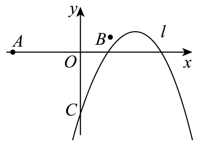

# Mathematics - 题目 2889

**ID**: 0d19b6cf05a94e5e97147e5d6304fdb1
**年级**: Grade 9
**难度**: Medium-Hard
**题型**: Calculation

## 题目
如图，已知点 $O\left ({0,0}\right ),A\left ({-9,0}\right ),B\left ({4,2}\right )$ ，抛物线 $l:y=-{\left({x-h}\right)^{2}}+2$ （h为常数）与y轴的交点为C．(1)l经过点B，求它的解析式，并写出此时l的对称轴及顶点坐标；​​​​​​​‌(2)设点C的纵坐标为 $y{{}_{c}}$ ，求 $y{{}_{c}}$ 的最大值，此时l上有两点 $\left ({x{{}_{1}},y{{}_{1}}}\right ),\left ({x{{}_{2}},y{{}_{2}}}\right )$ ，其中 $x{{}_{1}}>x{{}_{2}}\geqslant 0$ ，比较 $y{{}_{1}}$ 与 $y{{}_{2}}$ 的大小；(3)当线段 $OA$ 被l只分为两部分，且这两部分的比是 $2:7$ 时，求h的值．

## 解答

1. （1）解：将点 $B\left ({4,2}\right )$ 代入抛物线 $l:y=-{\left({x-h}\right)^{2}}+2$ 得， $-{\left({4-h}\right)^{2}}+2=2$ ，
2. 解得 $h=4$ ，
3. 所以抛物线 $l$ 的解析式为 $y=-{\left({x-4}\right)^{2}}+2$ ，
4. 所以这个抛物线的对称轴为直线 $x=4$ ，顶点坐标为 $\left ({4,2}\right )$ ．
5. （2）解：∵抛物线 $l:y=-{\left({x-h}\right)^{2}}+2$ （ $h$ 为常数）与 $y$ 轴的交点为 $C$ ，且点 $C$ 的纵坐标为 $y{{}_{c}}$ ，
6. ∴ $y{{}_{c}}=-{\left({0-h}\right)^{2}}+2=-h{^{2}}+2$ ，
7. ∵ $h{^{2}}\geqslant 0$ ，
8. ∴ $-h{^{2}}+2\leqslant 2$ ，即 $y{{}_{c}}\leqslant 2$ ，
9. ∴ $y{{}_{c}}$ 的最大值为2，此时 $h=0$ ，
10. ∴此时抛物线 $l$ 的解析式为 $y=-x{^{2}}+2$ ，
11. 由二次函数的性质可知，当 $x\geqslant 0$ 时， $y$ 随 $x$ 的增大而减小，
12. ∵此时 $l$ 上有两点 $\left ({x{{}_{1}},y{{}_{1}}}\right ),\left ({x{{}_{2}},y{{}_{2}}}\right )$ ，其中 $x{{}_{1}}>x{{}_{2}}\geqslant 0$ ，
13. ∴ $y{{}_{1}}<y{{}_{2}}$ ．
14. （3）解：∵ $A\left ({-9,0}\right )$ ，
15. ∴ $OA=9$ ，
16. ∵线段 $OA$ 被 $l$ 只分为两部分，且这两部分的比是 $2:7$ ，
17. ∴抛物线 $l$ 与线段 $OA$ 的交点坐标为 $\left ({-2,0}\right )$ 或 $\left ({-7,0}\right )$ ，
18. ①当抛物线 $l$ 与线段 $OA$ 的交点坐标为 $\left ({-2,0}\right )$ 时，
19. 则 $-{\left({-2-h}\right)^{2}}+2=0$ ，解得 $h=-2+\sqrt {2}$ 或 $h=-2-\sqrt {2}$ ，
20. 当 $h=-2+\sqrt {2}$ 时，抛物线 $l$ 的对称轴为直线 $x=-2+\sqrt {2}$ ，此时抛物线 $l$ 与 $x$ 轴的另一个交点为 $\left ({-2+2\sqrt {2},0}\right )$ ，符合题意；
21. 当 $h=-2-\sqrt {2}$ 时，抛物线 $l$ 的对称轴为直线 $x=-2-\sqrt {2}$ ，此时抛物线 $l$ 与 $x$ 轴的另一个交点为 $\left ({-2-2\sqrt {2},0}\right )$ ，位于线段 $OA$ 上，即此时线段 $OA$ 被 $l$ 分成三部分，不符合题意，舍去；
22. ②当抛物线 $l$ 与线段 $OA$ 的交点坐标为 $\left ({-7,0}\right )$ 时，
23. 则 $-{\left({-7-h}\right)^{2}}+2=0$ ，解得 $h=-7+\sqrt {2}$ 或 $h=-7-\sqrt {2}$ ，
24. 当 $h=-7+\sqrt {2}$ 时，抛物线 $l$ 的对称轴为直线 $x=-7+\sqrt {2}$ ，此时抛物线 $l$ 与 $x$ 轴的另一个交点为 $\left ({-7+2\sqrt {2},0}\right )$ ，位于线段 $OA$ 上，即此时线段 $OA$ 被 $l$ 分成三部分，不符合题意，舍去；
25. 当 $h=-7-\sqrt {2}$ 时，抛物线 $l$ 的对称轴为直线 $x=-7-\sqrt {2}$ ，此时抛物线 $l$ 与 $x$ 轴的另一个交点为 $\left ({-7-2\sqrt {2},0}\right )$ ，符合题意.
26. 综上， $h$ 的值为 $-2+\sqrt {2}$ 或 $-7-\sqrt {2}$ ．

## 知识点

**中文**:
  - 二次函数与不等式（组）
  - 二次函数的综合
  - 待定系数法求二次函数解析式
  - 二次函数的对称

**English**:
  - Quadratic Functions and Inequalities
  - Comprehensive Quadratic Function Problems
  - Finding Quadratic Expressions by Undetermined Coefficients
  - Symmetry of Quadratic Functions

---
