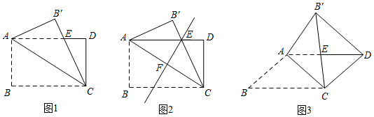

# Mathematics - 题目 3700

**ID**: 0d1bee7f78604bcda14fe8adf327c0a4
**年级**: Grade 9
**难度**: Medium-Hard
**题型**: Calculation

## 题目
课题学习：矩形折纸中的数学实践操作：折纸不仅是一项有趣的活动，也是一项益智的数学活动．数学课上，老师给出这样一道题将矩形纸片ABCD沿对角线AC翻折，使点B落在矩形所在平面内，B'C和AD相交于点E，如图1所示．探素发现：（1）在图1中，①请猜想并证明AE和EC的数量关系；​​​​​​​‌②连接B'D，请猜想并证明B'D和AC的位置关系；（2）第1小组的同学发现，图1中，将矩形ABCD沿对角线AC翻折所得到的图形是轴对称图形．若沿对称轴EF再次翻折所得到的图形仍是轴对称图形，展开后如图2所示，请你直接写出该矩形纸片的长、宽之比；（3）若将图1中的矩形变为平行四边形时（AB≠BC），如图3所示，（1）中的结论①和结论②是否仍然成立，请直接写出你的判断．拓展应用：（4）在图3中，若∠B＝30°，AB＝2，请您直接写出：当BC的长度为多少时，△AB'D恰好为直角三角形．

## 解答

1. 解：（1）如图1中，
2. 
3. ①结论：EA＝EC．
4. 理由：∵四边形ABCD是矩形，
5. ∴AD∥BC，
6. ∴∠EAC＝∠ACB，
7. 由翻折可知：∠ACB＝∠ACE，
8. ∴∠EAC＝∠ECA，
9. ∴EA＝EC．
10. ②连接DB′．结论：DB′∥AC．
11. ∵EA＝EC，
12. ∴∠EAC＝∠ECA，
13. ∵AD＝BC＝CB′，
14. ∴ED＝EB′，
15. ∴∠EB′D＝∠EDB′，
16. ∵∠AEC＝∠DEB′，
17. ∴∠EB′D＝∠EAC，
18. ∴DB′∥AC．
19. （2）如图2中，
20. 
21. ①当AB：AD＝1：1时，四边形ABCD是正方形，
22. ∴∠BAC＝∠CAD＝∠EAB′＝45°，
23. ∵AE＝AE，∠B′＝∠AFE＝90°，
24. ∴△AEB′≌△AEF（AAS），
25. ∴AB′＝AF，
26. 此时四边形AFEB′是轴对称图形，符合题意．
27. ②当AD：AB＝ $\sqrt {3}$ 时，也符合题意，
28. ∵此时∠DAC＝30°，
29. ∴AC＝2CD，
30. ∴AF＝FC＝CD＝AB＝AB′，
31. ∴此时四边形AFEB′是轴对称图形，符合题意．
32. （3）如图3中，当四边形ABCD是平行四边形时，仍然有EA＝EC，DB′∥AC．
33. 
34. 理由：∵四边形ABCD是平行四边形，
35. ∴AD∥BC，
36. ∴∠EAC＝∠ACB，
37. 由翻折可知：∠ACB＝∠ACE，
38. ∴∠EAC＝∠ECA，
39. ∴EA＝EC．
40. ∵EA＝EC，
41. ∴∠EAC＝∠ECA，
42. ∵AD＝BC＝CB′，
43. ∴ED＝EB′，
44. ∴∠EB′D＝∠EDB′，
45. ∵∠AEC＝∠DEB′，
46. ∴∠EB′D＝∠EAC，
47. ∴DB′∥AC．
48. （4）①如图3﹣1中，当∠AB′C＝90°时，易证∠BAC＝90°，
49. BC＝ $\frac {AB}{{\cos}30^\circ }=\frac {4\sqrt {3}}{3}$ ．
50. 
51. ②如图3﹣2中，当∠ADB′＝90°时，易证∠ACB＝90°，BC＝AB•cos30°＝ $\sqrt {3}$ ．
52. 
53. ③如图3﹣3中，当∠DAB′＝90°时，易证∠B＝∠ACB＝30°，
54. BC＝2•AB•cos30°＝2 $\sqrt {3}$ ．
55. 
56. ④如图3﹣4中，当∠DAB′＝90°时，易证：∠B＝∠CAB＝30°，
57. BC＝ $\frac {\frac {1}{2}{\rm{A}}{\rm{B}}}{{\cos}30^\circ }=\frac {2\sqrt {3}}{3}$ ，
58. 
59. 综上所述，满足条件的BC的长为 $\frac {4\sqrt {3}}{3}$ 或 $\sqrt {3}$ 或2 $\sqrt {3}$ 或 $\frac {2\sqrt {3}}{3}$ .

## 知识点

**中文**:
  - 四边形综合
  - 解直角三角形

**English**:
  - Comprehensive Quadrilateral Problems
  - Solving Right Triangles

---
