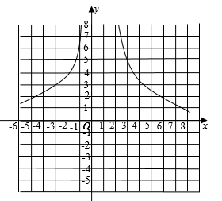

# Mathematics - 题目 3747

**ID**: 0e01797a9045404da5d2c67cb474424c
**年级**: Grade 9
**难度**: Medium-Hard
**题型**: Calculation

## 题目
已知y＝a|2x+4|+bx（a，b为常数）．当x＝1时，y＝5；当x＝﹣1时，y＝3．（1）a＝，b＝；（2）在给出的平面直角坐标系中，请用你喜欢的方法画出这个函数图象；并写出函数的一条性质：；（3）已知函数y＝ $\frac {25}{|2x-2|}$ 的图象如图所示，结合你所画的函数图象，直接写出方程a|2x+4|+bx＝ $\frac {25}{|2x-2|}$ 的近似解（精确到0.​​​​​​​‌1）．

## 解答

1. 解：（1）根据题意可得， $\left \{\hspace{-0.5em}\begin{array}{}\left |{2+4}\right |a+b=5\\\left |{-2+4}\right |a-b=3\end{array}\hspace{-0.5em}\right.$  ，解得 $\begin{cases}a=1\\b=-1\end{cases}$ ，
2. 故答案为：1；﹣1；
3. （2）根据题意，当x⩾﹣2时，2x+4⩾0，y＝2x+4﹣x＝x+4；
4. 当x＜-2时，2x+4＜0，则y＝﹣2x﹣4﹣x＝﹣3x﹣4．
5. ∴ $y=\begin{cases}x+4,(x\geqslant -2)\\-3x-4,(x<-2)\end{cases}$ ；
6. 由函数解析式可画出对应的函数图象，根据函数图象可得出对应函数的性质．
7. 
8. 故答案为：当x⩾﹣2时，y随x的增大而增大；
9. （3）根据函数图象，交点的横坐标就是该方程的解，根据图象估算对应的解为：x_{1}＝﹣2.5，x_{2}＝2.8；

## 知识点

**中文**:
  - 函数的应用

**English**:
  - Applications of Functions

---
