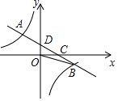

# Mathematics - 题目 394

**ID**: 0e0a2b9eb7c34c76bb19961a0e79b9ea
**年级**: Grade 9
**难度**: Medium-Hard
**题型**: Calculation

## 题目
如图，一次函数y＝ar＋b（a≠0）的图象与反比例函数y＝ $\frac {k}{x}$ （k≠0）的图象交于A、B两点，与x轴、y轴分别交于C、D两点，与x轴、y轴分别交于C，D两点，若OD＝2，sin∠ACO＝ $\frac {\sqrt {5}}{5}$ ，点A的坐标为（m，3）．（1）求反比例函数与一次函数的解析式；​​​​​​​‌（2）连接OB，点P在直线AC上，且S_{△}_{AOP}＝2S_{△}_{BOC}，求点P的坐标．

## 解答

1. 解：（1）∵Rt△COD中，OD＝2，sin∠ACO＝ $\frac {\sqrt {5}}{5}$ ，
2. ∴CD＝2 $\sqrt {5}$ ，CO＝4，
3. ∴D（0，2），C（4，0），
4. ∵直线y＝ax＋b（a≠0）与x轴、y轴分别交于C、D两点，
5. ∴ $\begin{cases}2=b\\0=4a+b\end{cases}$ ，解得： $\begin{cases}a=-\frac {1}{2}\\b=2\end{cases}$ ，
6. ∴一次函数的解析式为：y＝− $\frac {1}{2}$x＋2，
7. 把点A的坐标（m，3）代入，可得
8. 3＝− $\frac {1}{2}$m＋2，解得m＝−2，
9. ∴A（−2，3），
10. ∵反比例函数y＝ $\frac {k}{x}$ （k≠0）的图象经过点A，
11. ∴k＝−2×3＝−6，
12. ∴反比例函数解析式为y＝ $\frac {-6}{x}$ ；
13. （2）解方程组： $\begin{cases}y＝-\frac {1}{2}x+2\\y＝\frac {-6}{x}\end{cases}$ ，可得： $\begin{cases}x=-2\\y=3\end{cases}$ 或 $\begin{cases}x=6\\y=-1\end{cases}$ ，
14. ∴B（6，−1），
15. ∴S_{△}_{AOP}＝2S_{△}_{BOC}＝2× $\frac {1}{2}$ ×4×1＝4，
16. 设P（x，− $\frac {1}{2}$x＋2），
17. 分两种情况：
18. 
19. 点P在CD上时，S_{△}_{AOP}＝S_{△}_{AOD}＋S_{△}_{DOP}，
20. ∴4＝ $\frac {1}{2}$ ×2×2＋ $\frac {1}{2}$ ×2×|x|，解得：x＝2，（负根舍去）
21. ∴P（2，1）；
22. 点P'在CA延长线上时，S_{△}_{AOP'}＝S_{△}_{DOP'}_{−}S_{△}_{AOD}，
23. ∴4＝ $\frac {1}{2}$ ×2×|x|− $\frac {1}{2}$ ×2×2，解得x＝−6，（正根舍去）
24. ∴P'（−6，5）．
25. 综上所述，点P的坐标为（2，1）或（−6，5）．

## 知识点

**中文**:
  - 一次函数的实际应用
  - 反比例函数综合
  - 解直角三角形

**English**:
  - Applications of Linear Functions
  - Comprehensive Inverse Proportionality Problems
  - Solving Right Triangles

---
