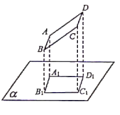

# Mathematics - 题目 870

**ID**: 0f259cab853d41e3b0c0172e81986e35
**年级**: Grade 9
**难度**: Medium-Hard
**题型**: Calculation

## 题目
（1）计算： $2\tan {^{2}}60{^{\circ }}-(\tan 45{^{\circ }}-\sqrt {3}){}^\circ +\left |{\frac {\sqrt {2}}{2}-\cos 30{^{\circ }}}\right |-{\left({\frac {1}{2}\sin 45{^{\circ }}}\right)^{-1}}$ ．（2）如图，正方形纸板 $ABCD$ 在投影面 $a$ 上的正投影为 $A{{}_{1}}B{{}_{1}}C{{}_{1}}D{{}_{1}}$ ，其中边 $AB、CD$ 与投影面平行， $AD,BC$ 与投影面不平行.​​​​​​​‌若正方形 $ABCD$ 的边长为 $5$ 厘米， $\angle BCC{{}_{1}}=45{^{\circ }}$ ，求其投影 $A{{}_{1}}B{{}_{1}}C{{}_{1}}D{{}_{1}}$ 的面积．

## 解答

1. (1)  $2\tan {^{2}}60{^{\circ }}-(\tan 45{^{\circ }}-\sqrt {3}){}^\circ +\left |{\frac {\sqrt {2}}{2}-\cos 30{^{\circ }}}\right |-{\left({\frac {1}{2}\sin 45{^{\circ }}}\right)^{-1}}$
2. ${\rm{=}}2{\left({\sqrt {3}}\right)^{2}}-1+\left |{\frac {\sqrt {2}}{2}-\frac {\sqrt {3}}{2}}\right |-(\frac {\sqrt {2}}{4}){^{-1}}$
3. ${\rm{=}}2{\left({\sqrt {3}}\right)^{2}}-1+(\frac {\sqrt {3}}{2}-\frac {\sqrt {2}}{2})-2\sqrt {2}$
4. ${\rm{=}}5+\frac {\sqrt {3}}{2}-\frac {5\sqrt {2}}{2}$  ；
5. (2)过点B作BE⊥CC_{1}于点E，
6. 
7. 在 $RtΔBCE$ 中， $\angle BCE=45{}^\circ $ ， $BC=5$ ，
8. ∴ $BE=BC{\sin}45{}^\circ =\frac {5\sqrt {2}}{2}$ ，
9. ∵ $BB{{}_{1}}$ ⊥ $B{{}_{1}}C{{}_{1}}$ ， $CC{{}_{1}}$ ⊥ $B{{}_{1}}C{{}_{1}}$ ，且BE⊥CC_{1}，
10. ∴四边形 $BB{{}_{1}}C{{}_{1}}E$ 为矩形，
11. ∴ $B{{}_{1}}C{{}_{1}}=BE=\frac {5\sqrt {2}}{2}$ ，
12. ∵ $C{{}_{1}}D{{}_{1}}=CD=5$ ，
13. ∴ $S{{}_{四边形A{{}_{1}}B{{}_{1}}C{{}_{1}}D{{}_{1}}}}=B{{}_{1}}C{{}_{1}}�C{{}_{1}}D{{}_{1}}=\frac {5\sqrt {2}}{2}�5=\frac {25\sqrt {2}}{2}$ ．

## 知识点

**中文**:
  - 平行投影

**English**:
  - Parallel Projection

---
