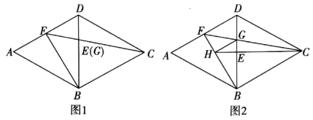

# Mathematics - 题目 204

**ID**: 0fd92519ddc84e648bc3fa27b26ea61b
**年级**: Grade 9
**难度**: Medium-Hard
**题型**: Calculation

## 题目
如图1，菱形 $ABCD$ 中， $\angle A=60{}^\circ $ ，F，E分别为 $AD,BD$ 边上的点，且 $DE=AF,CF$ 交 $BD$ 于点G， $AD=2$ ．（1）求证： $CE=BF$ ；​​​​​​​‌（2）当E点和G点重合时，求 $DF$ 的长；（3）如图2，延长 $CE$ 交 $BF$ 于点H，连接 $HG$ ，当F为 $AD$ 的中点时，求证： $GH\bot BF$ ．

## 解答

1. （1）证明：∵四边形 $ABCD$ 为菱形，
2. ∴ $AB=BC=CD=DA$ ， $\angle DCB=\angle A=60{}^\circ $ ．
3. ∵ $\mathrm{△}ABD$ 与 $\mathrm{△}BCD$ 是等边三角形
4. ∴ $AB=BC=CD=DA=BD=2$ ， $\angle EDC=60{}^\circ $ ．
5. ∵ $DE=AF,\angle EDC=\angle A=60{}^\circ ,AB=CD$ ，
6. ∴ $\mathrm{△}ABF\mathrm{≌}\mathrm{△}DCE$ ，
7. ∴ $CE=BF$ ．
8. （2）解：设 $DF=x$ ．
9. ∵四边形 $ABCD$ 为菱形，
10. ∴ $DF//BC$ ，
11. ∴ $\frac {DF}{BC}=\frac {DE}{BE}$ ，即 $\frac {x}{2}=\frac {2-x}{x}$ ．
12. 解得 $x=\sqrt {5}-1$ 或 $x=-\sqrt {5}-1$ （舍去）．
13. 故 $DF$ 的长是 $\sqrt {5}-1$ ．
14. （3）证明：证明：∵F为 $AD$ 的中点， $\mathrm{△}ABD$ 是等边三角形
15. ∴ $\angle DBF=30\mathrm{°}$ ，
16. ∴ $\angle FBC=\angle FBD+\angle DBC=90{}^\circ $ ．
17. ∵ $DF//BC$ ，
18. ∴ $\frac {DF}{BC}=\frac {DG}{GB}$
19. ∴ $\frac {DF}{BC}=\frac {DG}{BD-DG}$ 即： $\frac {1}{2}=\frac {DG}{2-DG}$ ,解得 $DG=\frac {2}{3}$ ，
20. ∵ $DE=AF=\frac {1}{2}AD=1$ ， $\mathrm{△}ABD$ 与 $\mathrm{△}BCD$ 是等边三角形，
21. ∴ $GE=DE-DG=1-\frac {2}{3}=\frac {1}{3}$ ． $\angle DBH=\angle ECB=30{}^\circ $ , $\angle HBC=\angle CEB=90{}^\circ $
22. ∴ $\vartriangle HEB∽\vartriangle BEC$ ，
23. ∴ $\frac {HE}{BE}=\frac {BE}{CE}=\frac {\sqrt {3}}{3}$ ，
24. ∴ $HE=\frac {\sqrt {3}}{3}$ ，
25. ∴ $\frac {GE}{HE}=\frac {\frac {1}{3}}{\frac {\sqrt {3}}{3}}=\frac {\sqrt {3}}{3}$ ，即 ${\tan}\angle GHE=\frac {\sqrt {3}}{3}$ ，
26. ∴ $\angle GHE=30{}^\circ $ ．
27. 又∵ $\angle HCB=30{}^\circ $ ，
28. ∴ $GH//BC$ ，
29. ∴ $GH\bot BF$ ．

## 知识点

**中文**:
  - 特殊角的三角函数值
  - 相似三角形的综合问题

**English**:
  - Trigonometric Values of Special Angles
  - Comprehensive Similar Triangle Problems

---
