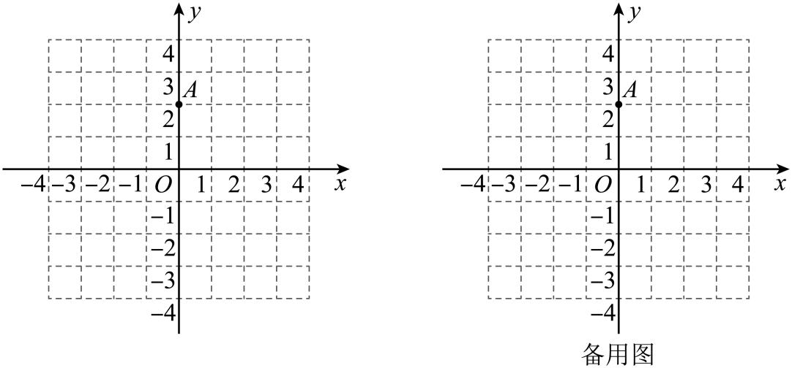

# Mathematics - 题目 3905

**ID**: 1000bf8643ac4564be36ed5ac55869bd
**年级**: Grade 9
**难度**: Medium-Hard
**题型**: Calculation

## 题目
在平面直角坐标系 $xOy$ 中， $\odot O$ 的半径为 $r$ ，点 $P$ 是 $\odot O$ 上一点．对平面内的一点 $Q$ ，先将点 $Q$ 关于点 $O$ 作中心对称变换得到点 $Q{{}_{1}}$ ，再将点 $Q{{}_{1}}$ 沿射线 $OP$ 的方向平移半径 $r$ 的长度得到点 $Q{{}_{2}}$ ，称为一次关于半径 $OP$ 的反射平移，点 $Q{{}_{2}}$ 称为点 $Q$ 关于半径 $OP$ 的反射平移点．如图，已知点 $A\left ({0,2}\right )$ ．(1)点 $P$ 是 $\odot O$ 上的动点， $OP=1$ ，则在 $A{{}_{1}}\left ({0,-1}\right )$ ， $A{{}_{2}}\left ({1,-1}\right )$ ， $A{{}_{3}}\left ({0,-2}\right )$ ， $A{{}_{4}}\left ({-\frac {\sqrt {2}}{2},-2-\frac {\sqrt {2}}{2}}\right )$ 中，可能是点 $A$ 关于半径 $OP$ 的反射平移点的是；​​​​​​​‌(2)直线 $l$ ： $y=\frac {\sqrt {3}}{3}x+b\left ({b>0}\right )$ 与 $x$ 轴交于点 $M$ ，与 $y$ 轴交于点 $N$ ．①当 $l$ 经过点 $A$ ，且 $P$ 的坐标为 $\left ({0,1}\right )$ 时，若线段 $MN$ 上一点 $B$ 关于半径 $OP$ 的反射平移点在 $\odot O$ 上或内部，直接写出点 $B$ 的横坐标 $x{{}_{B}}$ 的取值范围；②当直线 $l$ 经过点 $A$ ，且 $P$ 在 $y$ 轴的正半轴上时，若线段 $MN$ 上存在点 $C$ ，使点 $C$ 关于半径 $OP$ 的反射平移点在 $\odot O$ 上，求 $\odot O$ 的半径 $r$ 的取值范围；(3) $\odot O$ 的半径为1．若对于过点 $A$ 的线段 $AH$ 上每一点 $G$ （不含端点），都存在位于第一象限的点 $P$ ，使点 $G$ 关于半径 $OP$ 的平移反射点恰好在 $\odot O$ 上，直接写出线段 $AH$ 长度的最大值．

## 解答

1. （1）解：点 $A\left ({0,2}\right )$ 关于 $O$ 的对称点 $A^{′}{\left ({0,-2}\right )}$ ，
2. ∵ $A^{′}A^{′′}=OP=1$ ，则 $A^{′′}$ 在 $A^{′}$ 为圆心，1为半径的圆上，如图所示，
3. 
4. ∵ $A{{}_{1}}\left ({0,-1}\right )$ ， $A{{}_{2}}\left ({1,-1}\right )$ ， $A{{}_{3}}\left ({0,-2}\right )$ ， $A{{}_{4}}\left ({-\frac {\sqrt {2}}{2},-2-\frac {\sqrt {2}}{2}}\right )$ ，
5. $A{{}_{1}}A{{}_{3}}=-1+2=1$ ， $A{{}_{3}}A{{}_{4}}=\sqrt {{\left({\frac {\sqrt {2}}{2}}\right)^{2}}+{\left({-\frac {\sqrt {2}}{2}}\right)^{2}}}=1$ 则 $A{{}_{4}}$ 在 $\odot A^{′}$ 上
6. （2）①解：∵ $y=\frac {\sqrt {3}}{3}x+b\left ({b>0}\right )$ 经过点 $A$ ，
7. ∴ $b=2$
8. ∴ $y=\frac {\sqrt {3}}{3}x+2$ ，
9. 如图所示，线段 $MN$ 上一点 $B$ 关于半径 $OP$ 的反射平移点在 $\odot O$ 上或内部，即 $N^{′′}B^{′′}$ 在 $\odot O$ 的内部时，先中心对称再平移，
10. 
11. 当 $y=0$ 时， $x=-2\sqrt {3}$ ，则 $M\left ({-2\sqrt {3}，0}\right )$
12. ∴ $OM=2\sqrt {3}$
13. ∴ ${\tan}\angle MNO=60{}^\circ $
14. ∵线段经过反射平移后与 $y$ 轴的夹角不变，
15. ∴ $\angle ON^{′′}B^{′′}=60{}^\circ $
16. ∴当 $B^{′′}$ 在 $\odot O$ 上且不与点 $N^{′′}$ 重合时，连接 $OB^{′′}$ ，则 $\vartriangle OB^{′′}N^{′′}$ 即为所等边三角形，
17. ∴ $B^{′′}{\left ({\frac {\sqrt {3}}{2},-\frac {1}{2}}\right )}$
18. ∴ $B^{′}{\left ({\frac {\sqrt {3}}{2},-\frac {3}{2}}\right )}$ ， $B\left ({-\frac {\sqrt {3}}{2},\frac {3}{2}}\right )$
19. 结合图形，可得线段 $MN$ 上一点 $B$ 关于半径 $OP$ 的反射平移点在 $\odot O$ 上或内部时， $-\frac {\sqrt {3}}{2}\leqslant x{{}_{B}}\leqslant 0$
20. ②如图所示，当 $\odot O$ 与 $y=\frac {\sqrt {3}}{3}x+b\left ({b<0}\right )$ 相切时，为临界值；
21. 延长 $OC^{′′}$ 交 $M^{′}N^{′}$ 于点 $T$ ，作 $C^{′}C^{′′}{{\rm{/\mskip-4mu/}}}y$ 轴，则 $OT\bot M^{′}N^{′}$ ， $\angle ON^{′}T=60{}^\circ ,ON^{′}=ON=2$
22. ∴ $OT=2\times {\sin}60{}^\circ =\sqrt {3}$
23. ∴ $C^{′′}T=\sqrt {3}-r$ ，
24. ∵ $C^{′}C^{′′}{{\rm{/\mskip-4mu/}}}y$ 轴，则 $C^{′}C^{′′}=\frac {C^{′′}T}{{\sin}60{}^\circ }=\frac {\sqrt {3}-r}{\frac {\sqrt {3}}{2}}=2-\frac {2\sqrt {3}r}{3}$
25. 又 $C^{′}C^{′′}=r$
26. ∴ $2-\frac {2\sqrt {3}r}{3}=r$
27. 解得： $r=4\sqrt {3}-6$
28. 
29. ∴线段 $MN$ 上存在点 $C$ ，使点 $C$ 关于半径 $OP$ 的反射平移点在 $\odot O$ 上，  $\odot O$ 的半径 $r$ 的取值范围为： $r\geqslant 4\sqrt {3}-6$
30. （3）解：∵点 $G$ 关于半径 $OP$ 的平移反射点恰好在 $\odot O$ 上，
31. ∴点 $P$ 是在第一象限内的圆弧,如图即 $\overset{\frown}{{O^{′}PQ}}$ ，
32. ∵ $\odot O$ 的半径为1，则 $OP=1$ ，
33. 设 $\odot O$ 沿 $OP$ 方向平移 $1$ 个单位后的圆心为 $T$ ，则 $OP=OT$ ，根据定义可得 $P,T$ 关于原点对称，
34. ∴ $G$ 点在 $P$ 为圆心，半径为 $1$ 的圆上
35. 即点 $G$ 的轨迹为平面内到弧 $\overset{\frown}{{O^{′}PQ}}$ 距离为 $1$ 的点组成的图形，如图所示曲线组成的封闭图形，
36. 
37. ∴当 $AH$ 经过点 $O^{′}$ 时， $AH$ 取的最大值，
38. ∵ $OO^{′}=OP=1,AO=2$
39. ∴ $AH=\sqrt {2{^{2}}+1{^{2}}}+1=\sqrt {5}+1$ ．

## 知识点

**中文**:
  - 关于原点对称的点的坐标
  - 解直角三角形
  - 待定系数法求一次函数解析式

**English**:
  - Points Symmetric about Origin
  - Solving Right Triangles
  - Finding Expressions by Undetermined Coefficients

---
