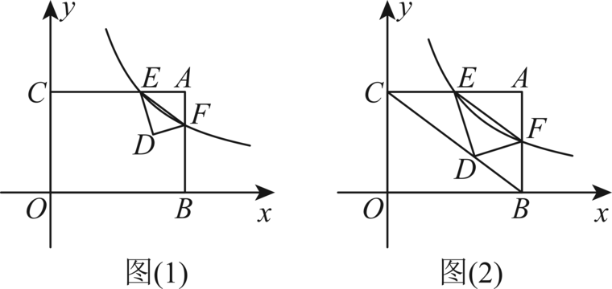

# Mathematics - 题目 97

**ID**: 112f1279cb054e50bdb632605fa3fc86
**年级**: Grade 9
**难度**: Medium-Hard
**题型**: Calculation

## 题目
如图（1），平面直角坐标系 $xOy$ 中，已知点 $A\left ({4,3}\right )$ ，反比例函数 $y=\frac {k}{x}\left ({k>0}\right )$ 的图象分别交矩形 $ABOC$ 的两边 $AC$ ， $AB$ 于 $E$ 、 $F$ 两点（ $E$ 、 $F$ 不与 $A$ 重合），沿着 $EF$ 将矩形 $ABOC$ 折叠使 $A$ 、 $D$ 两点重合．(1) $AE=$（用含有 $k$ 的代数式表示）；​​​​​​​‌(2)如图（2），当点 $D$ 恰好落在矩形 $ABOC$ 的对角线 $BC$ 上时．①证明： $EF{\rm{/\mskip-4mu/}}BC$②计算： $CE$ 的长度(3)若折叠后，连接 $AD$ ， $\mathrm{△}ABD$ 是等腰三角形，求此时点 $D$ 的坐标．

## 解答

1. （1）解：∵四边形 $ABOC$ 是矩形，且 $A(4,3)$ ，
2. $\therefore AC=4,OC=3$ ，
3. ∵点 $E$ 在反比例函数 $y=\frac {k}{x}$ 上，点 $E$ 的纵坐标为 3 ，
4. $\therefore E\left ({\frac {k}{3},3}\right )$ ，
5. $\therefore CE=\frac {k}{3}$ ，
6. $\therefore AE=4-\frac {k}{3}$ ，
7. 故答案为： $4-\frac {k}{3}$ ；
8. （2）①证明：∵ $A(4,3)$ ，
9. $\therefore AC=4,AB=3$ ，
10. $\therefore \frac {AC}{AB}=\frac {4}{3}$ ，
11. $\because $ 点 $F$ 在 $y=\frac {k}{x}$ 上，
12. $\therefore F\left ({4,\frac {k}{4}}\right )$ ，
13. $\therefore \frac {AE}{AF}=\frac {4-\frac {k}{3}}{3-\frac {k}{4}}=\frac {4}{3}$ ，
14. $\therefore \frac {AE}{AF}=\frac {AC}{AB}=\frac {4}{3}$ ，
15. 又 $\because \angle A=\angle A$ ，
16. $\therefore \vartriangle AEF∽\vartriangle ACB$ ，
17. $\therefore \angle AEF=\angle ACB$ ，
18. $\therefore EF{\rm{/\mskip-4mu/}}BC$ ．
19. ② $\because EF{\rm{/\mskip-4mu/}}BC$ ，
20. $\therefore \angle FED=\angle CDE$ ，
21. 根据折叠可得 $\vartriangle AEF≌\vartriangle DEF$ ，
22. $\therefore \angle AEF=\angle DEF,AE=DE$ ，
23. $\therefore \angle FED=\angle CDE=\angle AEF=\angle ACB$ ，
24. $\therefore CE=DE=AE=\frac {1}{2}AC=2$ ．
25. （3）解：连接 $AD$ 交 $EF$ 于 $M$ ，过 $D$ 点作 $DN\bot AB$ 于 $N$ ，
26. 由折叠的性质得 $AD\bot EF$ ，
27. 
28. 当 $BD=AD$ 时，如图3，
29. $\because \angle AND=90{}\degree $ ，
30. $\therefore AN=BN=\frac {1}{2}AB=\frac {3}{2},\angle DAN+\angle ADN=90{}\degree $ ，
31. $\because \angle DAN+\angle AFM=90{}\degree $ ，
32. $\therefore \angle ADN=\angle AFM$ ，
33. $\therefore {\tan}\angle ADN={\tan}\angle AFM=\frac {AE}{AF}=\frac {4}{3}$ ，
34. $\therefore \frac {AN}{DN}=\frac {4}{3}$ ，
35. $\because AN=\frac {3}{2}$ ，
36. $\therefore DN=\frac {9}{8}$ ，
37. $\because 4-\frac {9}{8}=\frac {23}{8}$ ，
38. $\therefore D\left ({\frac {23}{8},\frac {3}{2}}\right )$ ．
39. ②当 $AB=AD=3$ 时，如图4，
40. 
41. 在 $Rt\vartriangle ADN$ 中， ${\tan}\angle ADN={\tan}\angle AFM=\frac {AE}{AF}=\frac {4}{3}$ ，
42. $\therefore \frac {AN}{DN}=\frac {4}{3}$ ，
43. $\therefore \frac {AN}{AD}=\frac {4}{5}$ ，
44. $\therefore AN=\frac {4}{5}AD=\frac {4}{5}\times 3=\frac {12}{5}$ ，
45. $\therefore BN=3-AN=3-\frac {12}{5}=\frac {3}{5}$ ，
46. $\because DN=\frac {3}{4}AN=\frac {3}{4}\times \frac {12}{5}=\frac {9}{5}$ ，
47. $\because 4-\frac {9}{5}=\frac {11}{5}$ ，
48. $\therefore D\left ({\frac {11}{5},\frac {3}{5}}\right )$ ．
49. ③当 $AB=BD$ 时，
50. $\because \vartriangle AEF≌\vartriangle DEF$ ，
51. $\therefore DF=AF$ ，
52. $\therefore DF+BF=AF+BF$ ，即 $DF+BF=AB$ ，
53. $\therefore DF+BF=BD$ ，
54. 此时 $D,F,B$ 三点共线且 $F$ 点与 $B$ 点重合，不符合题意，舍去，
55. $\therefore AB\ne BD$ ，
56. 综上所述，所求 $D$ 点坐标为 $\left ({\frac {23}{8},\frac {3}{2}}\right )$ 或 $\left ({\frac {11}{5},\frac {3}{5}}\right )$ ．

## 知识点

**中文**:
  - 反比例函数的性质
  - 相似三角形的判定与性质综合
  - 解直角三角形
  - 折叠问题

**English**:
  - Properties of Inverse Proportionality Functions
  - Determination and Properties
  - Solving Right Triangles
  - Folding Problems

---
